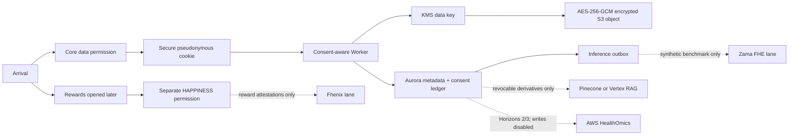

# Universal Mind citizen data foundation v0.1

This directory is the canonical design for consented cross-session memory. It is disabled and synthetic-only until the founder-approved consent interface, AWS staging resources and live-path verification are complete.

## What PostgreSQL owns

Aurora PostgreSQL is the source of truth for:

- pseudonymous citizen identity;
- the exact consent document version and append-only consent receipts;
- sessions, check-in lineage and Universal One conversation lineage;
- model and prompt provenance;
- first-party, allowlisted engagement events;
- data-use audit events;
- vector projection deletion references;
- access, export, correction and erasure workflows.

PostgreSQL does **not** contain plaintext check-ins, conversation turns or inference results. Those payloads are envelope-encrypted with AES-256-GCM before they enter an S3-compatible object store. The database contains the object reference, ciphertext hash and wrapped data key.

## Fixed request order

```text
arrival
  -> published consent document
  -> consent receipt + pseudonymous citizen + secure browser credential
  -> experience session
  -> encrypted check-in object
  -> check-in metadata transaction
  -> inference outbox event
  -> encrypted inference result
  -> explicitly approved, revocable projections
```

A check-in without an active consent receipt must fail closed. Consent, session, identity and deletion reads must never use a stale query cache.



## HAPPINESS separation

HAPPINESS is not a purpose code in this schema. Rewards registration appears only after a citizen deliberately enters Rewards. The rewards system may receive a separate opaque reward subject and privacy-safe attestation; it must not receive this database's citizen identifier, check-ins, conversations or inference results.

## Migration policy

1. Migrations are immutable after they have been applied anywhere.
2. Every change receives a new numbered migration.
3. Staging uses synthetic citizens until the consent UI is approved.
4. Row-level security is enabled and forced on every citizen-owned table.
5. Application transactions set `app.current_citizen_id` locally before any citizen query.
6. Migration and table-owner roles are never used by the application runtime.
7. Existing browser `localStorage` check-ins are never silently uploaded.

## Deletion semantics

An erasure request immediately withdraws future consent and revokes browser credentials. The erasure workflow then tracks PostgreSQL metadata, AWS S3 or Storj objects, vector projections, caches and backup expiry separately. Minimal append-only consent evidence may be retained only under a documented legal-retention rule; sensitive content is crypto-shredded and deleted.

## Files

- `migrations/0001_citizen_data_foundation.sql` — first PostgreSQL schema and default-deny RLS.
- `citizen-data-contract-v0.1.json` — machine-readable data-boundary contract.
- `infrastructure/aws/` — disabled infrastructure templates and SSO instructions.
