# Universal Mind Lab — supplied reference index

All 26 attachments are preserved in their original file formats and resolution. Friendly filenames begin with stable reference IDs. Original filenames, paths, file sizes and checksums are recorded in [the manifest](reference-manifest.json).

R17 and R18 are byte-identical duplicate attachments; both are retained. The index describes the visible content and its proposed use. It does not establish image reuse rights or a confirmed design partnership.

Add your comments under any image. Useful labels include **exact piece**, **preferred colour**, **form reference**, **atmosphere only**, **owned**, and **planned purchase**.

## Droneport architecture

### R02 — container and prototype

**Original filename:** Image 19.jpeg  
**Visible content:** Single Droneport prototype beside a shipping container and scaffold.  
**Design role:** Construction and logistics reference; road train replaces container-led arrival in the Lab story.

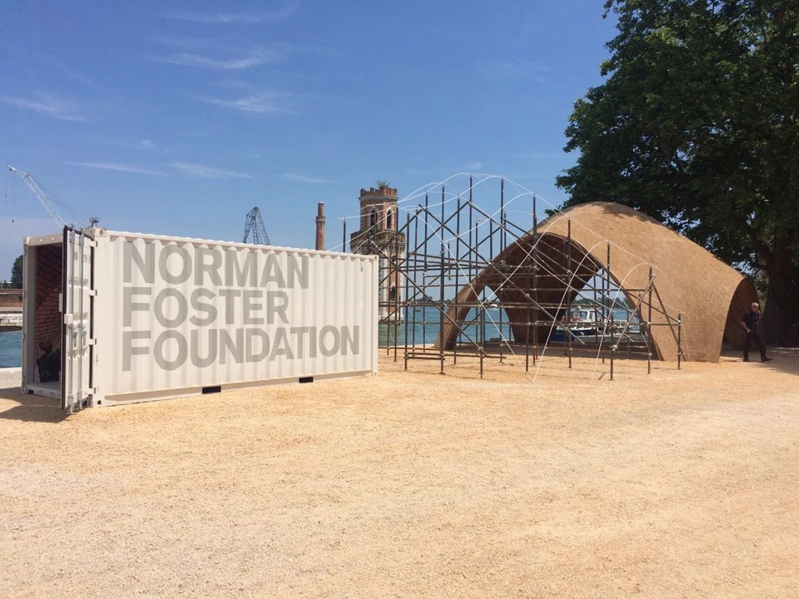

**Ben’s comments:**

- 

### R03 — assembly sequence

**Original filename:** Image 18.jpeg  
**Visible content:** Illustrated sequence of repeated vaults, components, workers and site assembly.  
**Design role:** Assembly narrative; sequence to be adapted with an actual construction method.

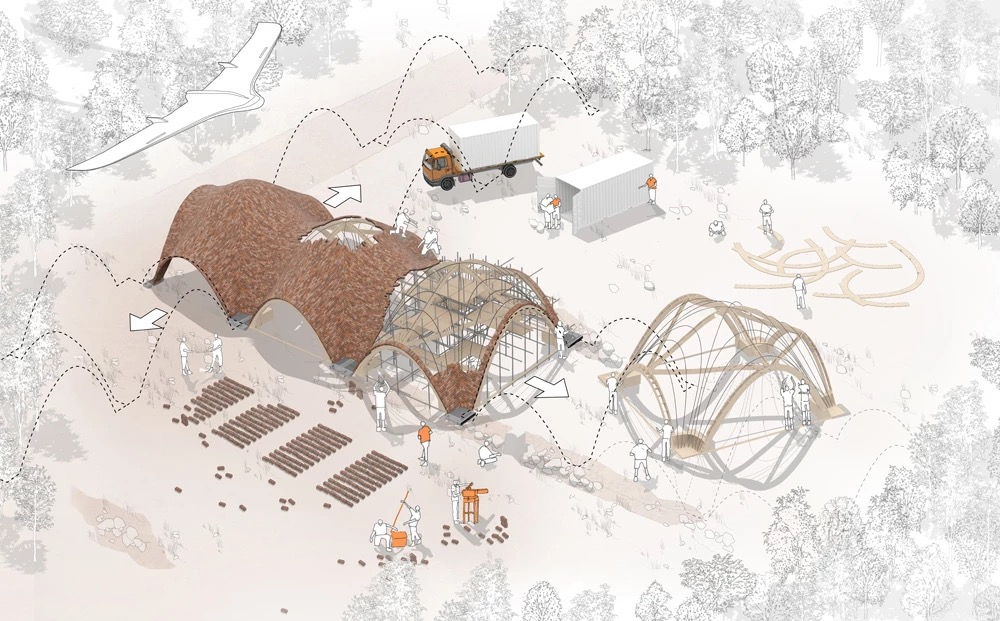

**Ben’s comments:**

- 

### R04 — workshop interior

**Original filename:** Image 17.jpeg  
**Visible content:** Vaulted masonry interior with workbenches and people.  
**Design role:** Interior scale, light and practical use.

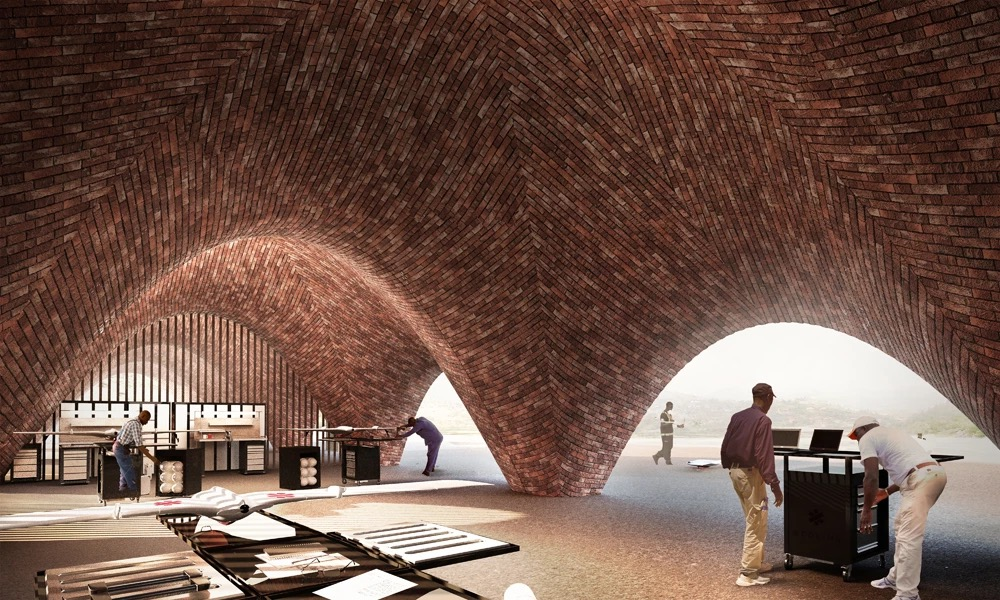

**Ben’s comments:**

- 

### R05 — community market interior

**Original filename:** Image 16.jpeg  
**Visible content:** Open masonry vaults occupied by a community market.  
**Design role:** Social life, openness and gathering.

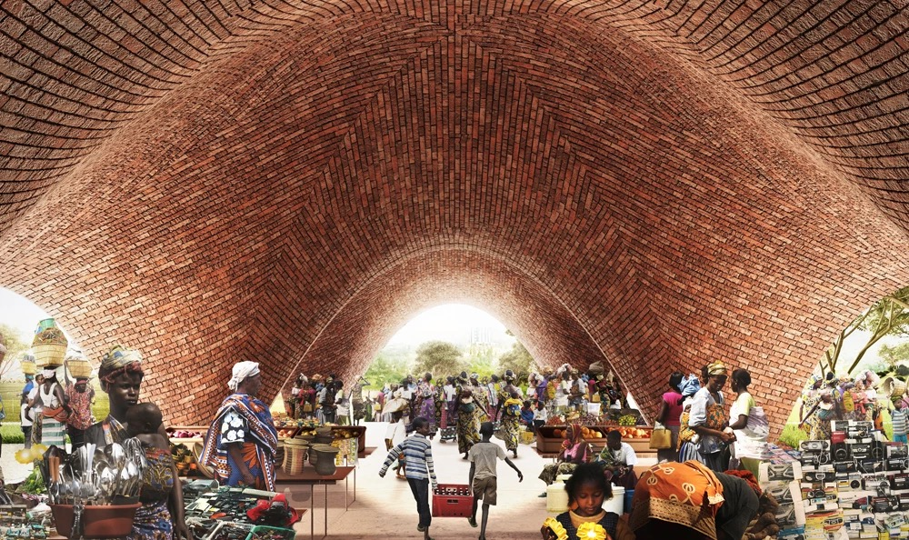

**Ben’s comments:**

- 

### R06 — long vaults boy and flag

**Original filename:** Image 15.jpeg  
**Visible content:** Long sequence of vaults in a landscape, with a boy holding a drone and a Redline flag.  
**Design role:** Ben's preferred long-term permanent-centre reference; the first community version uses one main vault.

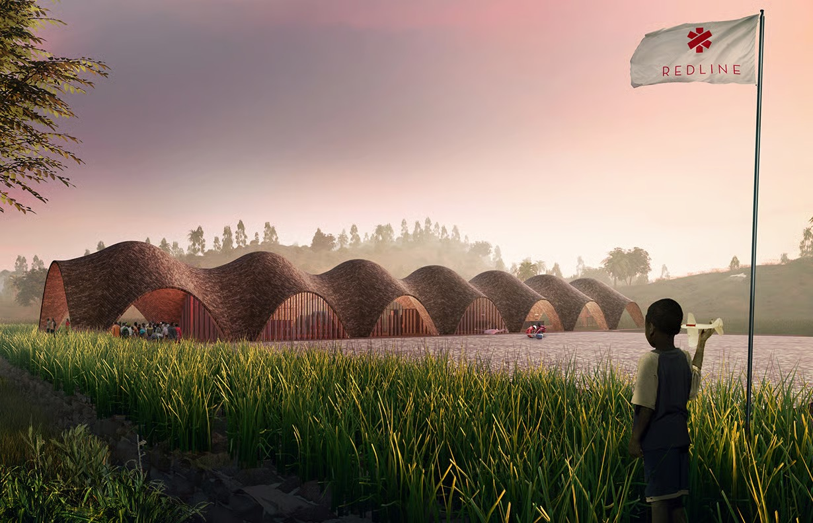

**Ben’s comments:**

- 

### R07 — single vault front

**Original filename:** Image 14.jpeg  
**Visible content:** Front view of the built single-vault prototype with people and scaffold.  
**Design role:** Primary initial architectural form reference.

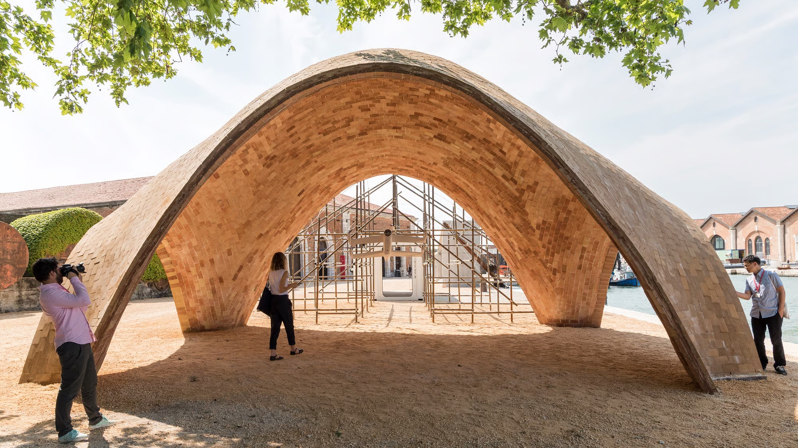

**Ben’s comments:**

- 

### R08 — vault edge and masonry

**Original filename:** Image 13.jpeg  
**Visible content:** Close view of vault edge, masonry layers and two people.  
**Design role:** Material and edge detail; technical assembly requires drawings.

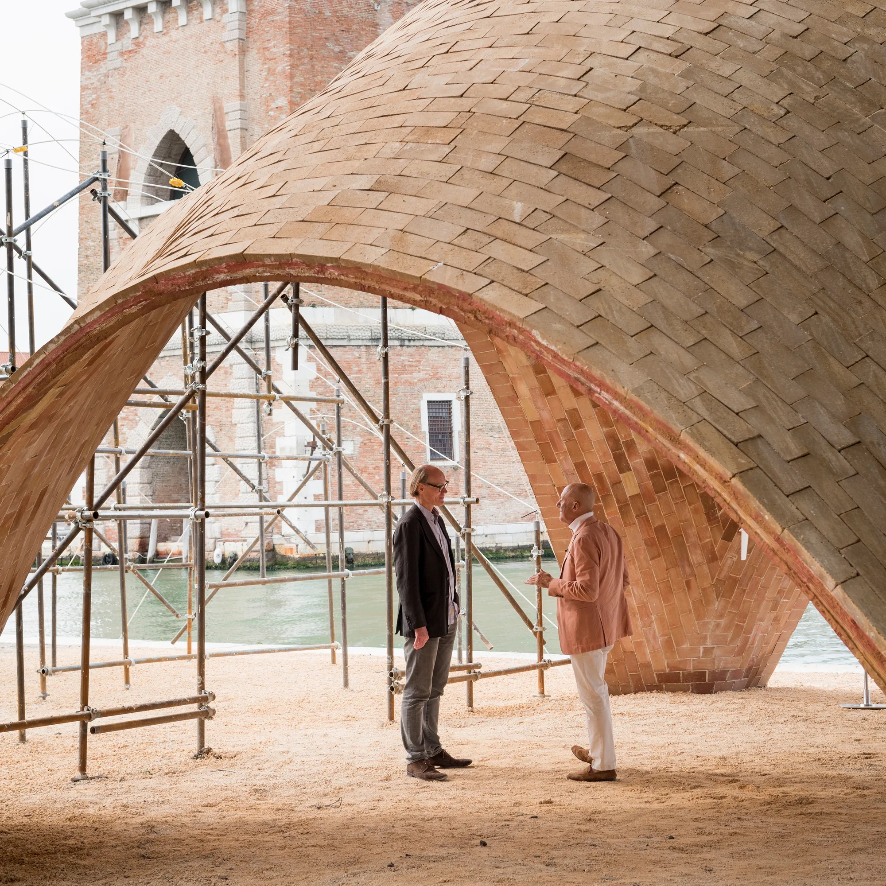

**Ben’s comments:**

- 

## Moroso Tropicália furniture

### R01 — rainbow weave detail

**Original filename:** Image.jpeg  
**Visible content:** Close view of purple, green and pink woven strands.  
**Design role:** Weave, colour and material detail.

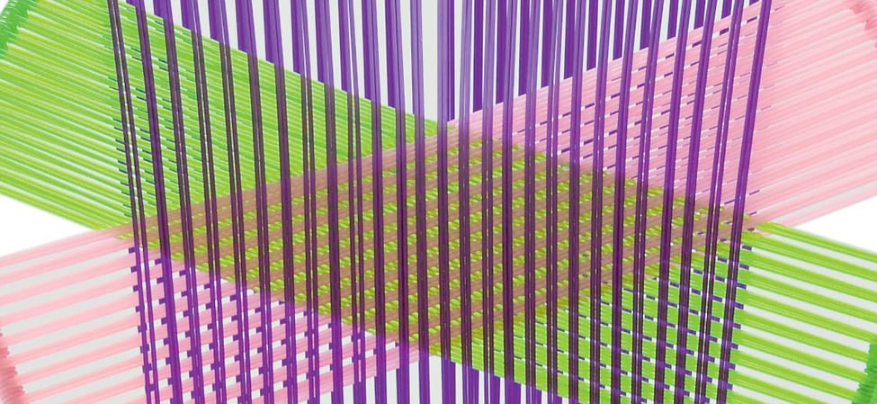

**Ben’s comments:**

- 

### R09 — rainbow daybed garden

**Original filename:** Image 12.jpeg  
**Visible content:** Rainbow woven day bed with cushions in a planted garden.  
**Design role:** Preferred day bed, soft furnishings and landscape relationship.

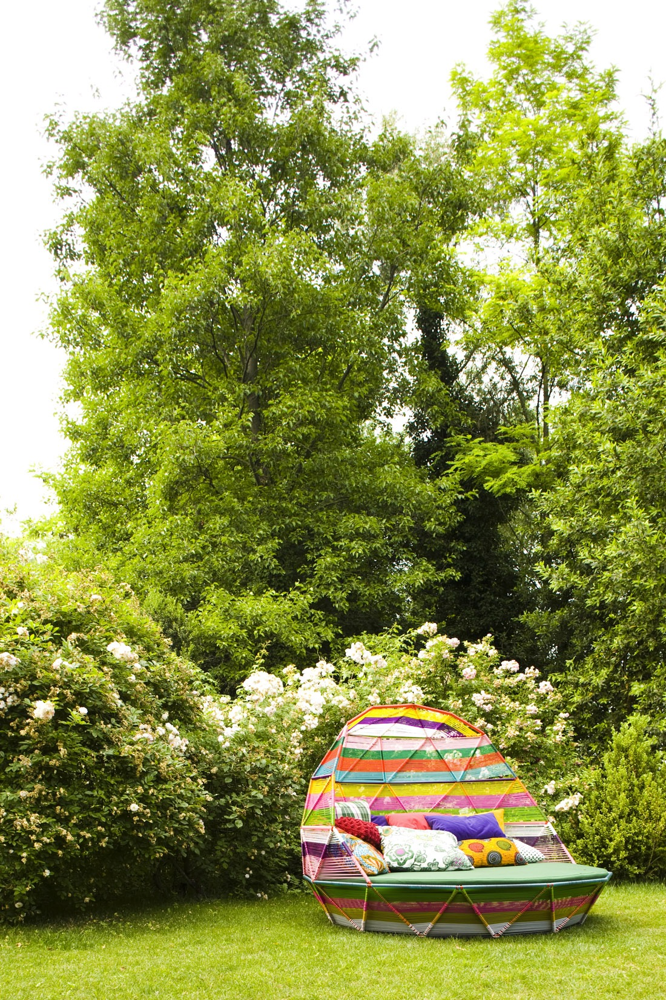

**Ben’s comments:**

- 

### R10 — rainbow armchair front

**Original filename:** Image 11.jpeg  
**Visible content:** Multicoloured woven armchair, front view.  
**Design role:** Chair geometry and colour blocking.

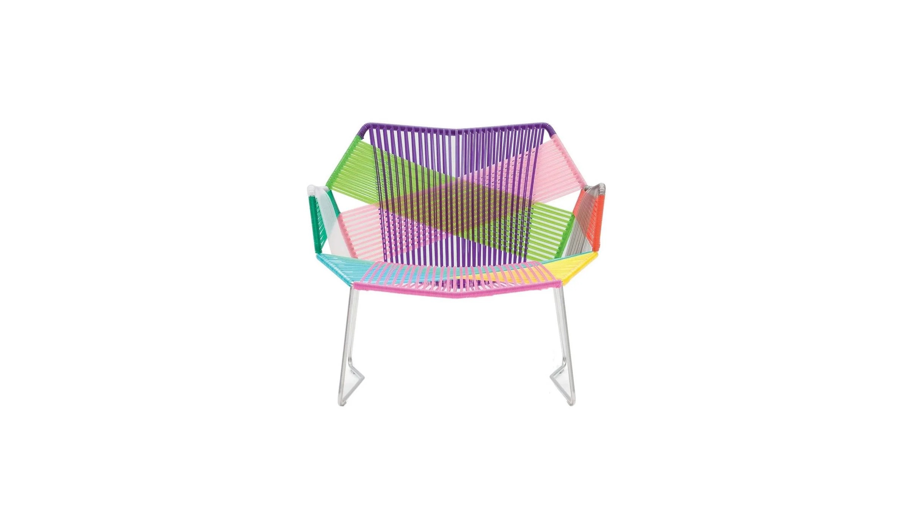

**Ben’s comments:**

- 

### R11 — rainbow armchair angle

**Original filename:** Image 10.jpeg  
**Visible content:** Multicoloured woven armchair, three-quarter view.  
**Design role:** Chair geometry and colour blocking; complements R10.

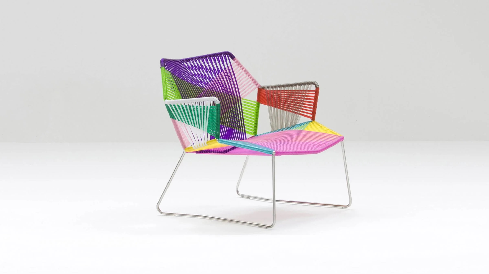

**Ben’s comments:**

- 

### R12 — rainbow low chair

**Original filename:** Image 9.jpeg  
**Visible content:** Low armless woven chair with many colours.  
**Design role:** Alternate chair shape and size.

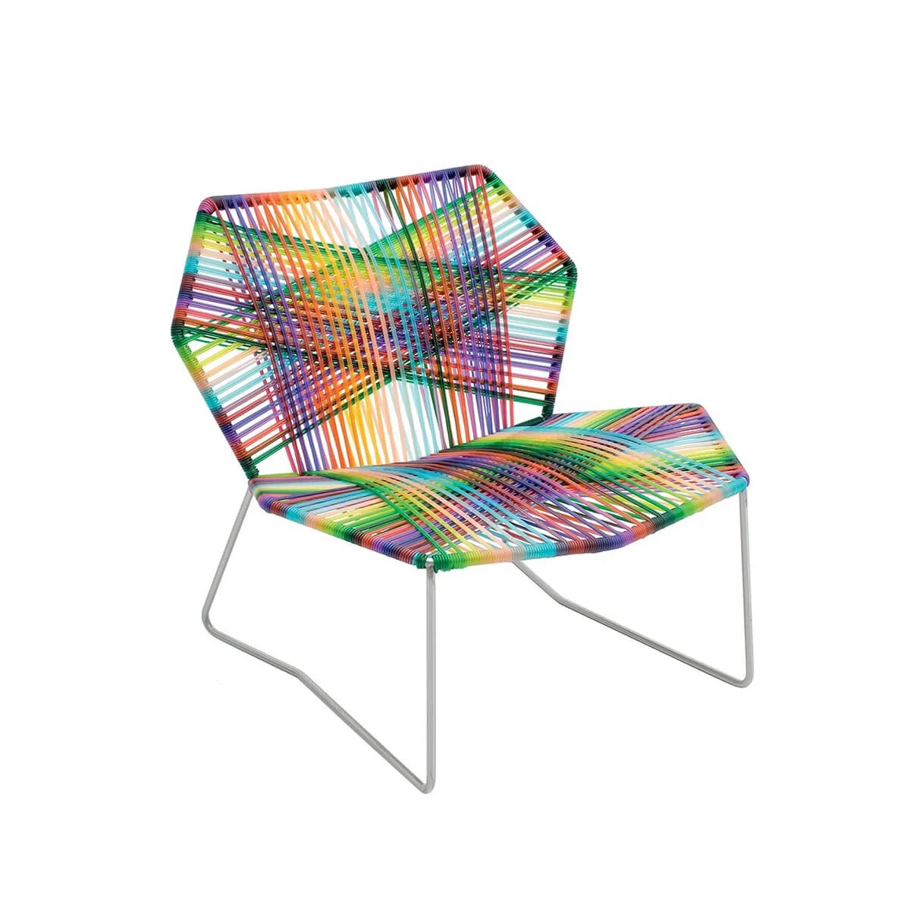

**Ben’s comments:**

- 

### R13 — rainbow hanging cocoon

**Original filename:** Image 8.jpeg  
**Visible content:** Rainbow hanging cocoon with cushions, viewed from the front.  
**Design role:** Primary suspended seat reference.

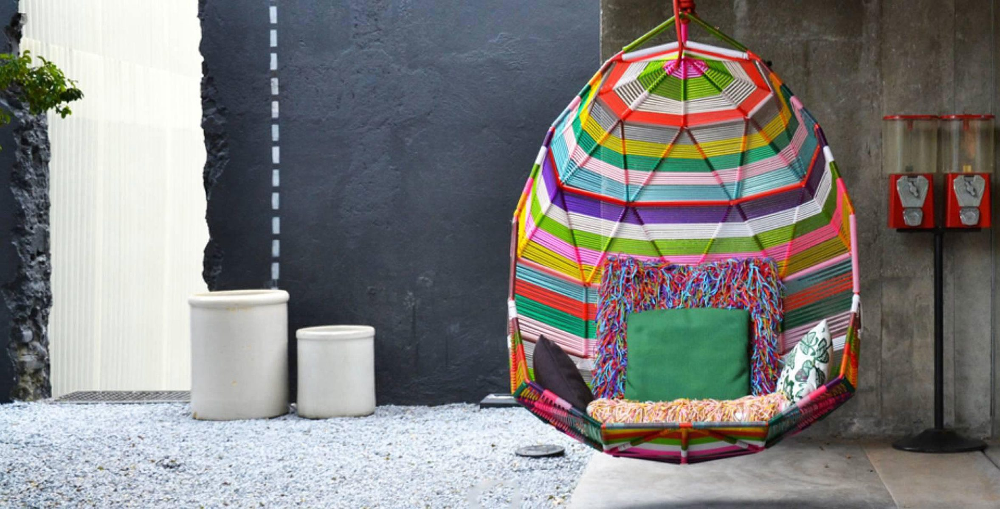

**Ben’s comments:**

- 

### R14 — cocoon weave and cushions

**Original filename:** Image 7.jpeg  
**Visible content:** Close view of hanging-seat weave and textured cushions.  
**Design role:** Soft furnishings and tactile detail.

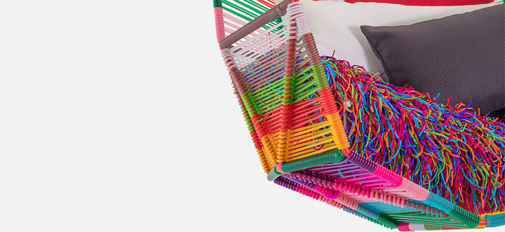

**Ben’s comments:**

- 

### R15 — hanging cocoon angle

**Original filename:** Image 6.jpeg  
**Visible content:** Angled hanging cocoon with a patterned cushion in a garden.  
**Design role:** Seat depth, suspension and landscape reference.

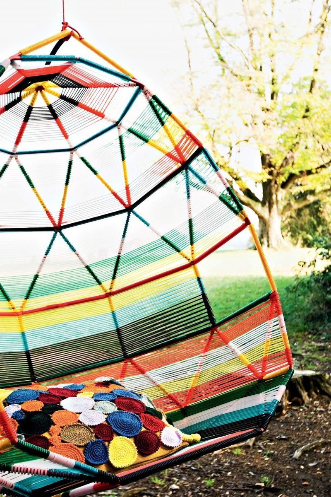

**Ben’s comments:**

- 

### R16 — cocoons among trees

**Original filename:** Image 5.jpeg  
**Visible content:** Several rainbow cocoons hanging among mature trees.  
**Design role:** Listening garden atmosphere; suspension details remain subject to design.

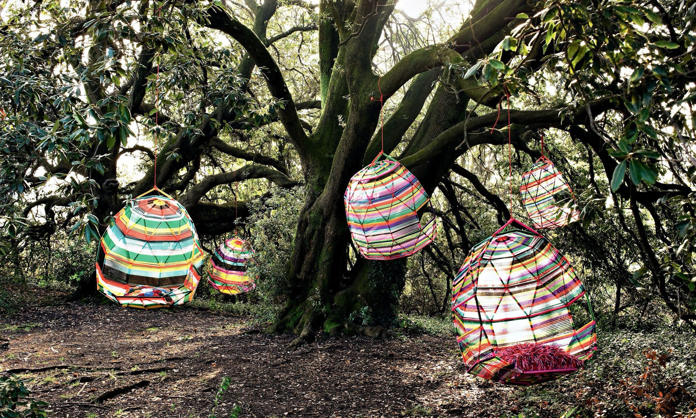

**Ben’s comments:**

- 

### R17 — single cocoon sheltered

**Original filename:** Image 3.jpeg  
**Visible content:** Single rainbow cocoon beneath a concrete canopy.  
**Design role:** Sheltered hanging seat and relationship to garden.

**Ben’s comments:**

- 

### R18 — single cocoon sheltered repeat

**Original filename:** Image 3.jpeg  
**Visible content:** Second supplied attachment of the sheltered single cocoon.  
**Design role:** Retain as a separate supplied attachment; compare checksum with R17.

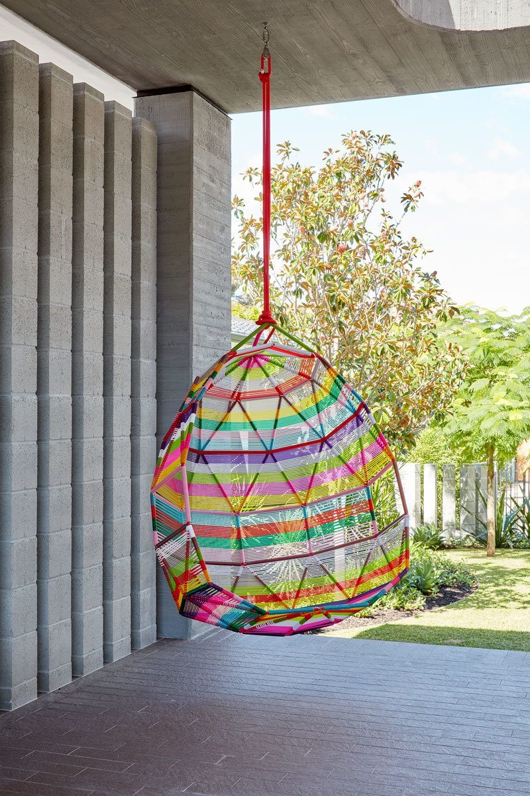

**Ben’s comments:**

- 

### R19 — upright chair front

**Original filename:** Image 2.jpeg  
**Visible content:** Upright woven chair with red, green and pale strands.  
**Design role:** Additional chair form; rainbow treatment remains Ben's direction.

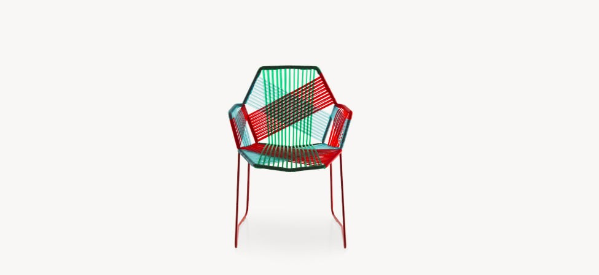

**Ben’s comments:**

- 

### R20 — upright chair angle

**Original filename:** Image 1.jpeg  
**Visible content:** Three-quarter view of the upright woven chair.  
**Design role:** Additional chair form; complements R19.

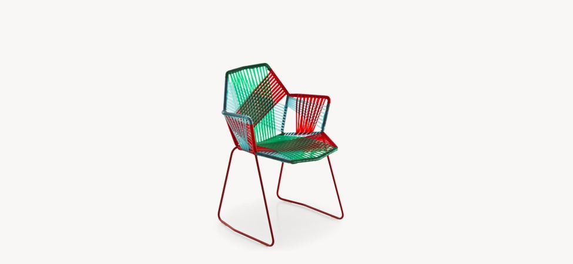

**Ben’s comments:**

- 

## ZHA structures

### R21 — striatus underneath

**Original filename:** Screenshot 2026-11-02 at 12.34.39 pm.png  
**Visible content:** Striatus underside with two children running beneath it.  
**Design role:** Curved segmented form and assembly reference; this project is a footbridge.

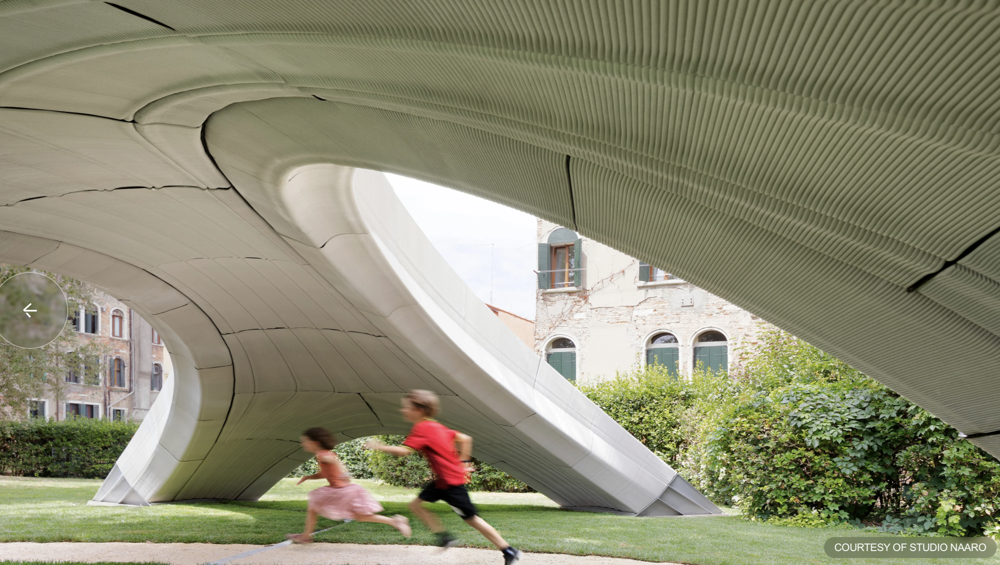

**Ben’s comments:**

- 

### R22 — striatus side

**Original filename:** Screenshot 2026-11-02 at 12.34.48 pm.png  
**Visible content:** Side view of Striatus with people above and below.  
**Design role:** Structural geometry reference; not an off-the-shelf pavilion.

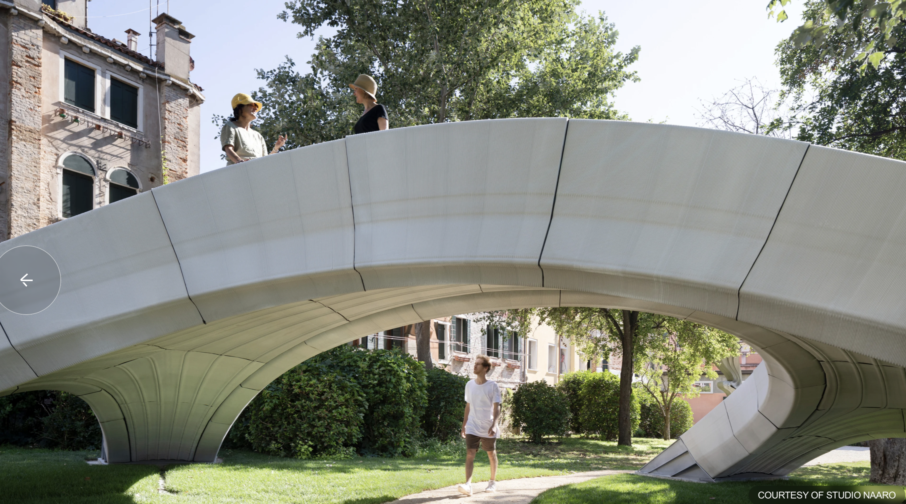

**Ben’s comments:**

- 

### R23 — striatus stairs

**Original filename:** Screenshot 2026-11-02 at 12.34.57 pm.png  
**Visible content:** Striatus stairs and segmented curved sides.  
**Design role:** Component geometry and visitor movement reference.

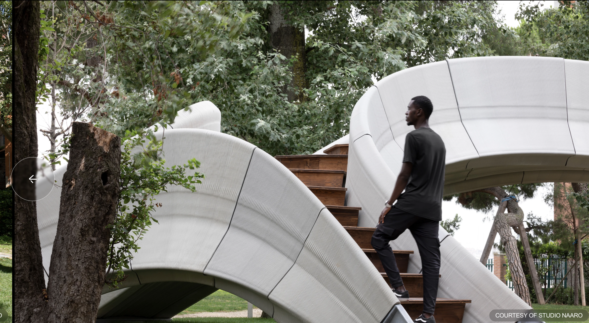

**Ben’s comments:**

- 

### R24 — volu dining pavilion

**Original filename:** Image 20.jpeg  
**Visible content:** Volu pavilion with orange and yellow canopy panels in a garden.  
**Design role:** Food pavilion form, shelter and garden integration.

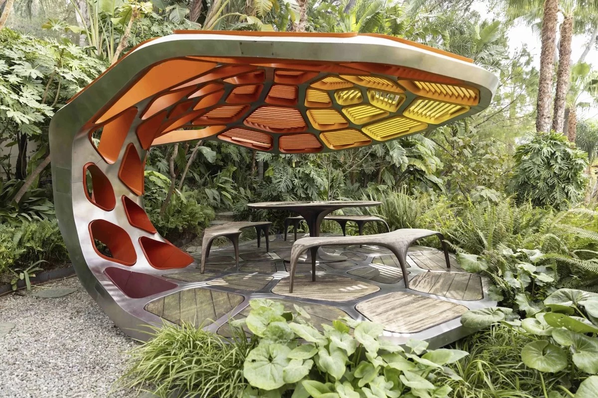

**Ben’s comments:**

- 

### R25 — volu table and floor

**Original filename:** Image 21.jpeg  
**Visible content:** Volu table, curved benches and patterned floor.  
**Design role:** Dining arrangement and organic detailing; furniture decision remains open.

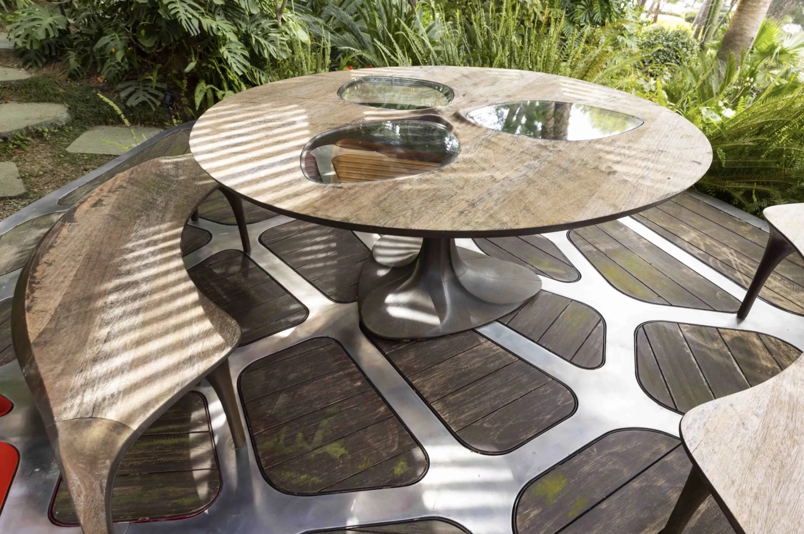

**Ben’s comments:**

- 

## R26 — Marketing and free membership doodle

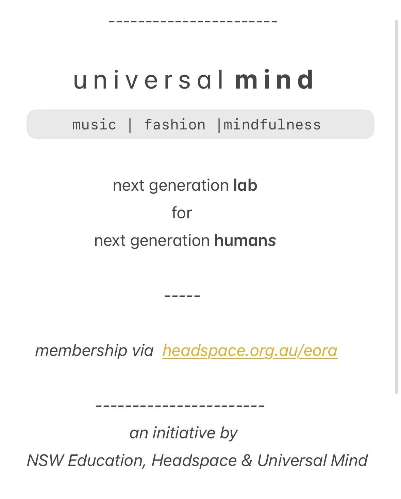

Original: IMG_2479.jpeg. Core language: Universal Mind; music | fashion | mindfulness; next generation lab for next generation humans. The headspace route and joint initiative attribution are draft proposals.

**Ben’s comments:** Free membership, applications/referrals through participating headspace services and NSW schools; limited in-person places and an online live-TV experience.
