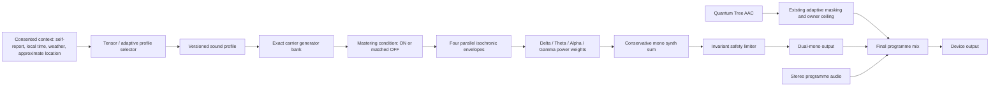

# I AM EMDR Adaptive Sound Synth

## Canonical A-Z Product, DSP, Interface and Research Blueprint

| Field | Canonical value |
| --- | --- |
| Document status | Canonical blueprint, version 1.1 |
| Created | 10 August 2026, Australia/Sydney |
| Updated | 12 August 2026, Australia/Sydney |
| Product | Universal Mind / Vogue I AM portal |
| Feature | EMDR Sound Research Layer expansion |
| Owner | Ben Korbel / Universal Mind |
| Scope | Strategy and implementation blueprint only |
| Implementation authority | This document does not itself authorise implementation, deployment or production release |
| Canonical file | `research/I_AM_EMDR_ADAPTIVE_SOUND_SYNTH_CANONICAL_BLUEPRINT.md` |

---

## 1. Purpose of this document

This is the permanent source of truth for the proposed adaptive sound feature inside the I AM EMDR experience. It exists so that context compaction, a new engineering session, a new contributor, or a long gap between stages cannot cause the concept to drift.

Every future strategy, design, engineering, research, QA and release task concerning this feature must begin by reading this file in full.

This document translates the founder's spoken brief, supplied PDFs, Solfeggio screenshots, handwritten diagrams, existing Quantum Tree implementation and primary-source checks into one standalone specification. The essential content of the temporary image attachments is transcribed here so the blueprint does not depend on those temporary paths remaining available.

### 1.1 Authority order

If two sources disagree, use this order:

1. Ben's newest explicit correction or decision.
2. This canonical blueprint after it has been updated to record that decision.
3. The supplied diagrams and source documents.
4. Existing code, comments, mock-ups or earlier brainstorming.
5. Engineering defaults or assumptions.

No contributor may silently reinterpret a locked decision. When Ben changes a locked decision, update this file and its decision log before or alongside the corresponding implementation.

### 1.2 Status vocabulary

| Status | Meaning |
| --- | --- |
| **LOCKED** | Explicitly decided by Ben; must not change without a new explicit decision |
| **BASELINE** | Describes the existing product that must be preserved or deliberately migrated |
| **RESEARCH HYPOTHESIS** | A proposed condition or association to test; not an established biological or clinical fact |
| **PROVISIONAL** | Recommended engineering or study starting value requiring calibration or approval |
| **OPEN** | A real unresolved decision that must not be guessed during implementation |
| **SUPERSEDED** | Appeared in earlier material but has been replaced by a later decision |

---

## 2. One-page canonical brief

Universal Mind will expand the existing EMDR Sound Research Layer into a browser-native, mono, adaptive soft synth that complements the existing Quantum Tree mix. The Quantum Tree remains the always-available proprietary baseline and retains its existing owner-only back-panel controller. The new synth adds a four-point adaptive diamond of isochronic modulation rates:

- Delta / Sleep: **3.33 Hz +/-**
- Theta / Mindfulness: **7.38 Hz +/-**
- Alpha / Calm: **10.11 Hz +/-**
- Gamma / Inspiration: **exactly 111 Hz +/-**

The four lanes coexist at different power weights. Horizon 1 uses four locked dominant profiles: 80% for the selected lane, 6.66% for each secondary lane, 0.01% deterministic noise and 0.01% silence reserve. The current voluntary self-report, optional current 10-second Heart Rate observation, local time, weather and approximate location contribute to one semantic inference; the deterministic policy then resolves one profile and one carrier for that session only. Time, weather and location influence the initial adaptive decision in Horizons 1, 2 and 3. Automatic mid-session profile morphing remains deferred until a later explicitly approved capability.

The carrier research set is **111, 222, 444, 555 and 999 Hz**. The initial transcriptomic mappings are hypotheses only:

- 111 Hz -> SLC6A4
- 222 Hz -> CD38
- 444 Hz -> DOCK2
- 555 Hz -> OXTR
- 999 Hz -> DRD2

The product algorithm uses a separate experience-intent layer: 111 cognition and joy; 222 connection to self, body and mind, personal love and happiness; 444 presence and self-awareness; 555 connection to community, family and unconditional nonjudgmental love; 999 connection to earth, breath, hydration, grounding / on Country, focus and reward. The transcriptomic rows never influence product selection.

The sound must feel warm, dimensional and authentically 1970s rather than cold, analytical or like a thin digital photocopy. It will be generated in real time; it will not rely on recorded analogue-chain WAV files. Its mastered condition will emulate a 1073-derived path, with the Red Rock Sound EQ173 used as the preferred tonal reference: gain-neutral harmonic colour that remains present at flat EQ, careful oversampling, cascaded transformer/Class-A character, vintage glue compression, a phase-aligned New York parallel compression path, and an exact **14,444 Hz low-pass roll-off**. The word “low-pass” is technically mandatory: a high-pass filter at 14,444 Hz would remove nearly all of the intended signal.

The research design must be able to disable the entire vintage mastering treatment while retaining the same carrier, isochronic modulation, duration, mono presentation, safety ceiling, latency and matched loudness. Mastering ON versus OFF is a test condition, not a participant-facing quality selector.

The listener interface is a restrained, beautiful hardware mix panel with a central diamond and truthful LED signal meters. “Vogue” means editorial judgment applied inside an authentic Kanye West or Fleetwood Mac studio environment; it does not mean fashion logos, Didot/Bodoni typography, ornamental magazine layouts or a faux Vogue skin on studio equipment.

The feature makes no wellness, treatment, diagnostic, neurological or gene-expression claim. Frequencies, genes and transcriptomic outcomes are displayed only as research hypotheses and measured conditions.

---

## 3. Hard locks: do not drift

### 3.1 Product and control locks

1. **LOCKED:** The existing Quantum Tree owner controller remains in place as the back panel for the website-wide Quantum Tree maximum.
2. **LOCKED:** The Quantum Tree is not replaced by the new synth.
3. **LOCKED:** The new adaptive synth complements the Quantum Tree.
4. **LOCKED:** The existing Quantum Tree audio file is not routed through the new mastering chain in version 1; preserving that baseline is necessary for continuity and experimental isolation.
5. **LOCKED:** Sound is on by default for a first-time eligible visitor, subject to browser autoplay rules and the user's right to turn it off.
6. **LOCKED:** The adaptive frequencies are enabled by default for a standard eligible session and can be disabled. For a high-concern session they remain off by default unless the citizen explicitly opts in for that session.
7. **LOCKED:** A previously saved user preference to turn the Sound Research Layer off must remain respected after migration.
8. **LOCKED:** Clicking the listener-facing Sound control opens the mix panel. The panel contains the actual master on/off control.
9. **LOCKED:** The mix panel is distinct from the owner-only Quantum Tree calibration page.
10. **LOCKED:** Music video and radio programme audio remains stereo. The research synth path is mono and is delivered as identical dual mono to left and right.
11. **LOCKED:** Horizon 1 resolves one band profile and one carrier from the current voluntary check-in for the current session only.
12. **LOCKED:** A citizen may override band/carrier for the current session only; the override is not a persistent automatic preference.
13. **LOCKED:** Time, weather and location influence every initial adaptive decision in Horizons 1, 2 and 3. The resolved Horizon 1 profile remains fixed until a new current inference or explicit citizen session choice; automatic continuous mid-session morphing remains deferred.
14. **LOCKED:** When high concern is present, Quantum Tree remains available/on subject to the citizen's existing master-off preference, adaptive frequencies default off, and human review takes priority.
15. **LOCKED:** A next-of-kin or clinician notification can occur only through a consented, verified and authorised human-in-the-loop pathway. The model never contacts a person.

### 3.2 Frequency locks

1. **LOCKED:** Delta = 3.33 Hz +/-.
2. **LOCKED:** Theta = 7.38 Hz +/-.
3. **LOCKED:** Alpha = 10.11 Hz +/-.
4. **LOCKED:** Gamma = exactly 111 Hz +/-.
5. **LOCKED:** Gamma must never be silently substituted with 40 Hz, 44.4 Hz or another conventional gamma-band value.
6. **LOCKED:** 111 Hz is the Gamma isochronic modulation rate in the diamond; it may also appear independently as a carrier condition.
7. **LOCKED:** 111 Hz phasing is not automatically an error. Ben accepts that phase interaction can sound pleasing and may increase the combined 111 Hz level when required.
8. **LOCKED:** The principal carrier research set is 111, 222, 444, 555 and 999 Hz.
9. **LOCKED:** New adaptive carrier choices must come from the supplied Solfeggio matrix allowlist unless Ben explicitly approves another condition.
10. **LOCKED:** The existing legacy research preset remains described separately as 7.38088 Hz isochronic modulation carried on 111.011 Hz, plus a separate constant 528.088 Hz sine wave. It must not be rounded or silently merged into the new adaptive definitions.

### 3.3 Mastering locks

1. **LOCKED:** This is a real-time browser soft synth emulating the desired signal path.
2. **LOCKED:** Real-world analogue hardware captures or mastering-chain WAV prints are out of scope for now.
3. **LOCKED:** The adaptive synth mastering path is mono.
4. **LOCKED:** The roll-off frequency is exactly 14,444 Hz.
5. **LOCKED:** The 14,444 Hz filter is a low-pass filter.
6. **LOCKED:** The mastered condition includes 1073-derived harmonic colour, vintage glue compression and New York parallel compression.
7. **LOCKED:** The parallel paths must be latency and phase aligned before summing.
8. **LOCKED:** Mastering must be bypassable as an experimental condition.
9. **LOCKED:** Mastering ON and OFF must be loudness matched and latency matched.
10. **LOCKED:** The final safety limiter is identical in both mastering conditions and sits outside the experimental variable.
11. **LOCKED:** Isochronic envelopes are applied after the colour and compression treatment so the compressor does not unintentionally erase or vary the intended modulation depth.

### 3.4 Scientific and public-language locks

1. **LOCKED:** No medical, clinical, wellness, neurological or gene-regulation benefit is claimed.
2. **LOCKED:** The carrier-to-gene rows are research hypotheses, not known mappings.
3. **LOCKED:** A signal meter may show audio level, mix weight and generated frequency; it must never imply that a brain, receptor or gene is responding.
4. **LOCKED:** The Solfeggio matrix is retained as founder-supplied mathematical and cultural source material, not represented as peer-reviewed biological evidence.
5. **LOCKED:** Environmental context is an adaptive input, not clinical evidence.
6. **LOCKED:** A research condition must be reproducible, versioned and auditable.

### 3.5 Design locks

1. **LOCKED:** The interface must look like an authentic, sophisticated instrument before it looks editorial.
2. **LOCKED:** Do not paste Vogue logos, fashion mastheads or faux editorial typography onto a sound console.
3. **LOCKED:** Avoid heavy Didot, Bodoni or high-fashion display-serif treatment for engineering controls.
4. **LOCKED:** The visual idea is Raytheon engineering, Apple interaction clarity, a real Kanye West or Fleetwood Mac studio, and Vogue-level curation and restraint.
5. **LOCKED:** The four-point diamond is the primary visual and conceptual model for Delta, Theta, Alpha and Gamma.

---

## 4. Explicit non-goals

The following are not authorised by this blueprint:

- Building or deploying the feature without a later explicit instruction.
- Replacing the Quantum Tree audio asset.
- Replacing or redesigning the owner Quantum Tree controller.
- Sending the existing music programme through mono processing.
- Recording a physical 1073, hardware console, tape machine or compressor and shipping the result as a sample.
- Copying, decompiling or extracting Red Rock Sound EQ173 proprietary code.
- Presenting the feature as treatment, therapy, diagnosis or proven brain entrainment.
- Claiming a frequency activates, modulates, heals, repairs or regulates a named gene.
- Inferring biological response from a playback meter.
- Giving listeners unrestricted gain that can push the research layer above its calibrated safety ceiling.
- Introducing a new deployment provider or bypassing the established Panthur staging workflow.

---

## 5. Source manifest

### 5.1 Founder-supplied source files

| Source | Role | SHA-256 |
| --- | --- | --- |
| `/Users/benkorbel/Desktop/i s o c h r o n i c  w e b  a u d i o  c h a i n.pdf` | Eight-page Gemini brainstorming document: Web Audio chain, analogue drift, saturation, example mapping and LED panel concepts | `a923b85e4048b965280dd9a9ef3a5c628967a817a8d35e63a398e6b1f02282eb` |
| `/Users/benkorbel/Downloads/RRS EQ173 iOS User Guide.pdf` | Preferred 1073-emulation tonal and behavioural reference | `88b4ade3d9c32ec8472381bca6afcedca72776e8090ba595dc0b0317ced8ee80` |
| `/Users/benkorbel/Desktop/Screenshot 2026-08-10 at 10.17.12 am.png` | Full Solfeggio matrix and Cube of Metatron subset table | `74673aa4f6a08f31584079062af7390d613c9908cc1904d0af5a1f36cd197a4e` |
| `/Users/benkorbel/Desktop/Screenshot 2026-08-10 at 10.17.21 am.png` | Supplied explanation of Solfeggio/Pythagorean-skein rules and Gateway-tone claims | `343e8a17c8821a72498c915ed3ccfac2a73af1b686222a46fbd9e8d8e33a211b` |
| `IMG_2190.jpeg` temporary Photos attachment | Handwritten four-point Delta/Theta/Alpha/Gamma adaptive diamond | `14179b03c45fbcbeecf834059540e5423cde502399f9a8d356e4f4505a0035a7` |
| `IMG_2189.jpeg` temporary Photos attachment | Handwritten carrier wave, candidate mRNA target and modulus/digital-root table | `9b677589d402c3c2eb8d46079fc656dd2d0ac6b5bc7413016260dcbfcfd357d2` |

The temporary Photos attachment paths are intentionally not treated as durable dependencies. Their essential content is transcribed in Sections 8, 9 and Appendix A.

### 5.2 Existing implementation references

The existing production concept is distributed across these files:

- `i  a m/index.html` - current EMDR wallet, Sound control and research disclosure.
- `i  a m/adaptive-environment-television.js` - current Quantum Tree playback, adaptive masking, preference and diagnostics.
- `i  a m/adaptive-environment-television.css` - current wallet and research-panel styling.
- `i  a m/quantum-tree-control.html`
- `i  a m/quantum-tree-control.css`
- `i  a m/quantum-tree-control.js`
- `i  a m/api/quantum-tree-settings.php`
- `i  a m/api/quantum-tree-settings.json`
- `i  a m/a s s e t s/q u a n t u m [ t r e e ].m4a`
- `i  a m/science.html`
- `i  a m/science-research-data-v1.js`
- `i  a m/technology-citizen-needs-server.mjs`
- `i  a m/adaptive-soundtrack-stage-gates.md`

The code baseline was inspected against the locally available `origin/staging` reference `afb00147c3895d8686ce09634786d5e82308b927` on 10 August 2026. That hash is provenance, not a permanent implementation pin.

### 5.3 Primary technical and research references

- [AMS Neve 1073 official architecture and specifications](https://www.ams-neve.com/outboard/1073-range/1073-mic-preamp-equaliser/)
- [Red Rock Sound EQ173 official product documentation](https://redrocksound.pro/en/eq173-pc/)
- [W3C Web Audio API 1.1](https://www.w3.org/TR/webaudio-1.1/)
- [WHO-ITU safe listening devices and systems standard](https://www.who.int/publications/i/item/9789241515276)
- [Human transcriptome after music listening, PMID 25789207](https://pubmed.ncbi.nlm.nih.gov/25789207/)
- [Music-listening and human microRNA expression, PMID 32867562](https://pubmed.ncbi.nlm.nih.gov/32867562/)
- [Buccal transcriptomic response to music, PMID 41064114](https://pubmed.ncbi.nlm.nih.gov/41064114/)
- [Theta binaural-beat systematic review, PMID 42349368](https://pubmed.ncbi.nlm.nih.gov/42349368/)
- [Auditory stimulation, autonomic arousal and cognition systematic review, PMID 38458383](https://pubmed.ncbi.nlm.nih.gov/38458383/)
- [G.W. Hardin Solfeggio source/provenance page](https://soundsofwonder.com/articles.html)
- NCBI Gene records: [SLC6A4](https://www.ncbi.nlm.nih.gov/gene/6532), [CD38](https://www.ncbi.nlm.nih.gov/gene/952), [DOCK2](https://www.ncbi.nlm.nih.gov/gene/1794), [OXTR](https://www.ncbi.nlm.nih.gov/gene/5021), [DRD2](https://www.ncbi.nlm.nih.gov/gene/1813)

These references establish feasibility, nomenclature and boundaries. They do not validate the proposed exact frequency-to-gene mappings.

---

## 6. Existing baseline that must be preserved

### 6.1 Quantum Tree audio

The current Quantum Tree is a pre-rendered proprietary audio mix:

| Property | Existing value |
| --- | --- |
| File | `i  a m/a s s e t s/q u a n t u m [ t r e e ].m4a` |
| Container/codec | M4A / AAC |
| Channels | 2 |
| Sample rate | 48,000 Hz |
| Estimated duration | 43.800312 seconds |
| Approximate bit rate | 191,991 bits per second |

This file is the Quantum Tree baseline. The fact that it is stereo does not change the requirement that the new synthesised research bus be generated in mono and delivered dual mono.

### 6.2 Existing owner calibration

The owner-only back panel currently controls one shared platform maximum for Quantum Tree. The public API exposes the current setting; writes require owner authentication, same-origin verification and CSRF protection.

Current baseline values include:

| Setting | Existing value |
| --- | ---: |
| Default/platform peak | 0.055 linear gain, approximately 5.5% / -25.2 dB |
| Silence floor | 0.012 |
| Full masking reference | 0.12 |
| Masking curve | 0.75 |
| Attack smoothing | 0.05 |
| Release smoothing | 0.12 |

The 5.5% value is a maximum ceiling, not a constant playback level. Normal playback adapts below that ceiling according to measured programme level. Silence gates the layer to zero; the existing continuity path can hold the saved peak when EMDR is active and programme media is interrupted.

**Preservation rule:** Do not repurpose this control to become the new synth master. Do not change its meaning while building the new feature. The listener panel may display Quantum Tree status, but it cannot overwrite the owner setting.

### 6.3 Existing listener behaviour

- The Sound Research Layer is currently on unless the browser has stored `iamSoundResearchLayer = "off"`.
- The current Sound control toggles the existing layer.
- The current source is an HTML audio element playing the Quantum Tree AAC.
- Current descriptive copy states: `Isochronic tone: 7.38088 Hz, carried on a 111.011 Hz sine wave, plus a separate constant 528.088 Hz sine wave, together as one.`
- Current public research copy proposes short-term transcriptional-pathway research and a double-blinded RCT with buccal-swab mRNA measurement.

The new interface changes the Sound button from direct toggle to panel opener. Migration must preserve the stored off preference and provide a clear master power control inside the panel.

---

## 7. Product architecture

### 7.1 Three distinct sound layers

The system must never collapse these into one concept:

| Layer | Meaning | Control authority |
| --- | --- | --- |
| Programme | Music video, DJ set or radio audio | Existing programme/player controls |
| Quantum Tree | Existing proprietary, pre-rendered Universal Mind sound mix | Existing owner back panel plus listener master off |
| Adaptive synth | New real-time carrier and four-lane isochronic diamond | Tensor profile, research condition and listener on/off/lane controls |

### 7.2 System overview



### 7.3 Isolation requirements

- A new-synth failure must not stop the music programme or Quantum Tree.
- A Quantum Tree configuration failure must fall back to its existing safe default, not expose arbitrary synth gain.
- The research condition must never alter programme selection.
- Programme audio must not be routed through the vintage mastering chain.
- Quantum Tree must not be routed through the vintage mastering chain in version 1.
- The adaptive synth must expose a diagnostic state independently of Quantum Tree diagnostics.

---

## 8. Adaptive diamond

### 8.1 Canonical four points

| Diamond point | Experience label | Nominal isochronic rate | Status |
| --- | --- | ---: | --- |
| Top | Sleep | 3.33 Hz +/- | Delta |
| Right | Mindfulness | 7.38 Hz +/- | Theta |
| Bottom | Calm | 10.11 Hz +/- | Alpha |
| Left | Inspiration | exactly 111 Hz +/- | Gamma |

The handwritten diagram is a diamond, not a conventional horizontal four-channel mixer. The diamond communicates that every session can be a blend of all four points rather than a mutually exclusive mode.

### 8.2 Meaning of `+/-`

`+/-` records the founder's intention that each state may occupy a controlled range around its nominal value. It does not authorise arbitrary pitch drift.

**OPEN:** The exact allowed range for each point must be defined in the research protocol and configuration schema before implementation. Until approved, software must use the nominal values exactly.

### 8.3 Horizon 1 power-weight profiles

The four product profiles use the exact implementation allocation already approved for the Phase 1 sound engine.

| Profile | Delta | Theta | Alpha | Gamma | Noise | Silence | Status |
| --- | ---: | ---: | ---: | ---: | ---: | ---: | --- |
| Sleep | 80% | 6.66% | 6.66% | 6.66% | 0.01% brown | 0.01% | LOCKED |
| Mindfulness | 6.66% | 80% | 6.66% | 6.66% | 0.01% white | 0.01% | LOCKED |
| Calm | 6.66% | 6.66% | 80% | 6.66% | 0.01% pink | 0.01% | LOCKED |
| Inspiration | 6.66% | 6.66% | 6.66% | 80% | 0.01% equal white/pink/brown | 0.01% | LOCKED |
| Balanced | 24.995% | 24.995% | 24.995% | 24.995% | 0.01% explicit lab choice | 0.01% | PROVISIONAL research/calibration profile only |

The four frequency lanes total `0.9998`; noise is `0.0001`; silence reserve is `0.0001`; the total is exactly `1.0`. Do not renormalise the secondary lanes to 6.666...% or erase the explicit noise/silence allocations.

### 8.4 Power weights are not raw amplitude multipliers

The displayed percentages describe intended power contribution. A power weight `w` maps to a linear amplitude multiplier of `sqrt(w)` before conservative headroom scaling.

For the Horizon 1 Sleep profile (frequency-lane subtotal 99.98%):

- Delta amplitude basis: `sqrt(0.8) = 0.894427...`
- Each minor-lane amplitude basis: `sqrt(0.0666) = 0.25807...`
- Delta power relative to the total: approximately -0.97 dB
- Each minor-lane power relative to the total: approximately -11.77 dB

This does not mean the final mix can sum those amplitudes without headroom. Isochronic envelopes can align, and coherent carriers can phase. The engine must use a deterministic worst-case headroom factor before the invariant limiter.

### 8.5 Lane-off behaviour

**PROVISIONAL SAFETY RULE:** Turning a lane off must not renormalise the remaining lanes upward. The total layer becomes quieter. This prevents a listener from unexpectedly increasing exposure by disabling one component.

### 8.6 Click-free activation and later transitions

Any start, stop or explicit citizen session change must be:

- phase-continuous;
- click-free;
- slow enough not to feel like a preset jump;
- deterministic and logged;
- performed in the power domain;
- free from a temporary loudness overshoot.

**LOCKED FOR HORIZON 1:** Do not automatically morph the resolved profile during the session. Use only the calibrated click-free ramp required to start, stop or apply an explicit session choice. Continuous adaptive profile morphing is a Horizon 2 capability; its duration remains open pending listening calibration.

---

## 9. Carrier conditions and transcriptomic hypotheses

### 9.0 Product carrier experience intents

| Carrier | Product experience intent | Algorithm status |
| ---: | --- | --- |
| 111 Hz | Cognition and joy | LOCKED Horizon 1 input |
| 222 Hz | Connection to self, body and mind; personal love and happiness | LOCKED Horizon 1 input |
| 444 Hz | Presence and self-awareness | LOCKED Horizon 1 input; never a silent default |
| 555 Hz | Connection to others, community and family; unconditional nonjudgmental love and happiness | LOCKED Horizon 1 input |
| 999 Hz | Connection to earth, breath, hydration, grounding / on Country; focus and reward | LOCKED Horizon 1 input |

These product meanings are experiential editorial intentions, not proven outcomes. They are the only carrier meanings available to the product resolver. The research table in Section 9.1 is stored separately and is never loaded by that resolver.

### 9.1 Canonical five-row matrix

| Carrier condition | Candidate mRNA target | NCBI name | Digital-root/modulus notation from sketch | Evidence status |
| ---: | --- | --- | ---: | --- |
| 111 Hz | SLC6A4 | solute carrier family 6 member 4 | 3 | RESEARCH HYPOTHESIS |
| 222 Hz | CD38 | CD38 molecule | 6 | RESEARCH HYPOTHESIS |
| 444 Hz | DOCK2 | dedicator of cytokinesis 2 | 3 | RESEARCH HYPOTHESIS |
| 555 Hz | OXTR | oxytocin receptor | 6 | RESEARCH HYPOTHESIS |
| 999 Hz | DRD2 | dopamine receptor D2 | 9 | RESEARCH HYPOTHESIS |

The speech-to-text form `DO2OXR` is resolved here as two separate symbols: **DOCK2** and **OXTR**. `DOC2` is not the canonical symbol for the 444 Hz row.

### 9.2 What the mapping means

The matrix defines candidate study conditions. It means:

> Compare transcriptomic measurements associated with controlled exposure conditions and investigate whether changes involving these preregistered targets differ across conditions.

It does not mean:

- that any carrier is known to modulate its paired gene;
- that the digital root creates a biological mechanism;
- that the genes are “neurotransmitter genes” in one interchangeable category;
- that expression in a buccal sample demonstrates expression in the brain;
- that an observed association proves clinical benefit or causation.

### 9.3 NMDAR nomenclature boundary

The current Sound research copy contains a wider exploratory list: `NMDAR`, `OXTR`, `SLC6A4`, `DRD2`, `IL6`, `NR3C1`, `DOCK2` and `CD38`. The five-row carrier matrix in Section 9.1 is the focused version 1 hypothesis set; it does not silently validate or erase the wider exploratory list. Any public-copy or protocol change must state which set is in scope.

NMDAR describes a receptor family, not one unique gene symbol. If this target remains in a later assay, the protocol must name the exact subunit gene or genes, such as a scientifically selected member of the `GRIN` family. Do not send `NMDAR` to a sequencing or targeted-expression pipeline as if it were a single gene identifier.

### 9.4 One carrier versus compound carriers

For interpretable first-stage research, use one carrier condition at a time. A compound carrier mix makes it impossible to attribute an observed difference to a single carrier without a much larger factorial design.

**LOCKED FOR HORIZON 1:**

- Study mode version 1: one of 111, 222, 444, 555 or 999 Hz per session.
- Exploratory product mode: exactly one carrier for the current session.
- Compound carriers are deferred beyond Horizon 1 and require a newly approved, explicitly versioned profile.

### 9.5 The 111/111 special case

111 Hz can be both:

- the selected carrier; and
- the Gamma isochronic modulation rate.

That condition must not be deduplicated or replaced. Amplitude modulation at the same numerical rate as the carrier produces a distinctive spectrum, and additional 111 Hz content may interact with the Quantum Tree mix. Ben accepts that 111 Hz phasing can sound pleasing. Engineering must therefore:

- preserve the intended condition;
- use an explicit deterministic phase policy;
- log synth phase and start time;
- provide conservative headroom;
- avoid labelling all phase interaction as a defect;
- still investigate clipping, cancellation and repeatability during QA.

The decoded Quantum Tree loop is not guaranteed to be phase-locked to the generated carrier. Do not claim sample-level phase control over the pre-rendered AAC.

---

## 10. Legacy Sound preset versus new adaptive engine

These are separate definitions:

| Property | Existing legacy Sound description | New adaptive engine |
| --- | --- | --- |
| Isochronic rate | 7.38088 Hz | Four-lane 3.33 / 7.38 / 10.11 / 111 Hz diamond |
| Carrier | 111.011 Hz | Versioned Solfeggio allowlist; initial study set 111/222/444/555/999 Hz |
| Additional constant tone | 528.088 Hz | Not automatically present unless a profile explicitly includes it |
| Rendering | Pre-rendered Quantum Tree AAC mix | Real-time soft synth |
| Adaptation | Existing masking under programme | Tensor-selected diamond weights plus masking/safety policy |

Do not “clean up” the legacy decimals. Do not assume that the legacy 528.088 Hz component proves or defines the new 555 Hz/OXTR hypothesis.

---

## 11. Canonical DSP signal path

### 11.1 Logical order

```mermaid
flowchart LR
    A["Exact mono carrier generator or versioned carrier bank"] --> B["Input operating-level calibration"]
    B --> C["1073-derived input-transformer model"]
    C --> D["Cascaded discrete Class-A colour stages"]
    D --> E["Inductor-EQ-derived tonal and phase character"]
    E --> F["1073-derived output-transformer model"]
    F --> G["Parallel split"]
    G --> H["Main path: gentle vintage glue"]
    G --> I["NY path: heavier compression plus colour"]
    H --> J["Latency/phase-aligned blend"]
    I --> J
    J --> K["Exact 14,444 Hz low-pass roll-off"]
    K --> L["Gain- and latency-calibrated mastered carrier"]
    L --> M["Split into Delta / Theta / Alpha / Gamma envelopes"]
    M --> N["Per-lane power weights and conservative headroom"]
    N --> O["Mono sum"]
    O --> P["Invariant safety limiter"]
    P --> Q["Dual-mono destination"]
```



### 11.2 Why modulation follows colour and compression

The carrier is coloured and compressed while continuous. The isochronic envelopes are applied afterward. This prevents the glue and New York compressors from reacting differently to every pulse, filling the troughs and reducing the intended modulation depth.

Moving compression after the envelopes creates a materially different stimulus and must be treated as a separate future research condition, not a refactor.

### 11.3 Generator requirements

The carrier generator must:

- run on the audio rendering thread;
- calculate phase from the actual `AudioContext.sampleRate`;
- use double-precision phase accumulation internally where practical;
- be sample-accurate and deterministic;
- start from a recorded phase rule or seeded phase;
- maintain phase continuity during gain and profile changes;
- never use `setInterval` or animation frames for pulse timing;
- expose actual sample rate, nominal frequency and condition version to diagnostics;
- apply short click-free ramps when starting, stopping or changing a carrier.

### 11.4 No unapproved oscillator drift

The Gemini PDF suggested slow analogue pitch drift of approximately +/-0.5 to +/-0.7 Hz. That is **SUPERSEDED for research conditions** because it changes the defined exposure frequency.

Warmth must initially come from harmonic, dynamic, frequency-dependent and phase behaviour, not from randomising the carrier or isochronic rate.

An optional aesthetic-only drift mode may be studied later if Ben explicitly approves it. It must be off in any exact-frequency study condition and its trajectory must be seeded and logged.

### 11.5 Isochronic envelope requirements

Each lane is amplitude modulation of the post-mastered carrier signal. The envelope generator must define and version:

- nominal modulation rate;
- exact allowed range if adaptation around the nominal is approved;
- duty cycle;
- minimum and maximum gain;
- attack curvature;
- hold duration;
- release curvature;
- initial phase;
- transition behaviour;
- phase relationship to the other lanes.

**PROVISIONAL:** Use a raised-cosine or similarly smooth pulse rather than a hard square gate. This retains a clear pulse while avoiding clicks and excessive broadband sidebands. The final duty cycle and depth require listening tests and protocol approval.

### 11.6 DC and numerical safety

- Every nonlinear stage must be stable for silence, denormals and full-scale input.
- Asymmetric stages require DC blocking that does not remove the intended low-frequency carrier content.
- Internal headroom must prevent NaN, infinity and runaway feedback.
- State reset must use a fade, not a discontinuous buffer clear.
- No stage may emit output after the master is safely stopped, apart from a documented release tail.

---

## 12. 1073-derived colour core

### 12.1 Authenticity target

The aim is not a trademark claim or a literal Neve product clone. The internal target is a Universal Mind colour path inspired by the electrical behaviours associated with a 1970s 1073 signal path and judged against the warmth Ben prefers in Red Rock Sound EQ173.

The authentic Neve reference includes:

- transformer-balanced input and output;
- discrete Class-A circuitry;
- multiple transistor gain stages;
- inductor-based three-band EQ;
- a fixed 12 kHz high shelf;
- selectable low shelf and mid bands;
- an actual 18 dB/octave high-pass filter at low frequencies.

The Universal Mind 14,444 Hz low-pass roll-off is an authored addition. Therefore the result must be described internally as **1073-derived** or **1073-inspired**, not as a literal 1073 circuit reproduction.

### 12.2 What the EQ173 reference contributes

The EQ173 guide reveals several behaviours worth preserving:

1. Preamp drive adds mild harmonic distortion without simply increasing output gain.
2. Colour remains when the EQ is disengaged and controls are flat.
3. Input and output gain can be adjusted independently of sonic character.
4. The EQ has a smooth fixed 12 kHz shelf, proportional/frequency-dependent mid behaviour and a smooth low shelf.
5. Processing can run at 2x, 4x or 8x oversampling, with a higher-order anti-aliasing mode.
6. Gain-matched A/B comparison is treated as essential to judging tone rather than loudness.

These are behavioural references, not disclosure of Red Rock Sound's proprietary algorithm.

### 12.3 Required modelling approach

A single memoryless `tanh` curve is insufficient. It tends to sound like a digital effect rather than a signal passing through equipment.

The colour core should use several gentle stages:

1. **Input operating level:** establishes calibrated headroom without changing the public output level.
2. **Input transformer stage:** subtle frequency-dependent saturation, low-frequency behaviour and asymmetry.
3. **Class-A stage A:** predominantly gentle second- and third-order colour.
4. **Class-A stage B:** a different transfer and operating point so harmonics build progressively rather than as one hard clip.
5. **Inductor/EQ character:** minimum-phase tonal and phase behaviour, not simply a graphic-EQ smile curve.
6. **Output transformer stage:** final soft saturation and bandwidth character.
7. **Compensating output trim:** equalises loudness without erasing the nonlinear response.

### 12.4 Statefulness

At least part of the model should be frequency dependent or stateful. Static EQ followed by a static waveshaper is the “photocopy” failure mode this feature must avoid.

Possible implementation methods, in order of initial practicality:

1. Cascaded oversampled nonlinear filters with measured and listening-calibrated transfer functions.
2. Antiderivative anti-aliased nonlinearities for efficient, lower-alias saturation.
3. Wave-digital-filter or circuit-derived stages if the first model cannot reach the required authenticity within the browser CPU budget.

### 12.5 Oversampling policy

**PROVISIONAL ENGINEERING BASELINE:** fixed 4x oversampling for every nonlinear colour stage.

The W3C permits `WaveShaperNode` 2x/4x oversampling but does not specify the exact resampling filters; latency and response may vary between browser engines. A research-grade implementation should therefore prefer custom, versioned oversampling inside an `AudioWorkletProcessor` or equivalent deterministic WASM DSP rather than relying solely on browser-defined `WaveShaperNode.oversample`.

- 8x may be used in the offline reference renderer and engineering comparison suite.
- Do not silently downgrade a participant from 4x to 2x because a device is slow.
- If the validated DSP cannot run reliably, fail closed to Quantum Tree-only and record the incompatibility.
- Any future lower-compute condition is a separately validated renderer version.

### 12.6 Tonal restraint

The output must remain warm, clear and dimensional. It must not become obviously distorted, fuzzy, crushed or hyped. The default colour target is audible in a matched A/B but not a special effect.

The 12 kHz shelf associated with the 1073 is not the 14,444 Hz roll-off. Do not substitute one for the other. A default 12 kHz boost is not required; any shelf voicing must be deliberately calibrated.

---

## 13. Vintage glue and New York parallel compression

### 13.1 Main glue path

Purpose: make the carrier colour feel cohesive and physical without audibly pumping or flattening the later isochronic envelope.

**PROVISIONAL STARTING RANGE:**

| Parameter | Starting range |
| --- | --- |
| Ratio | approximately 2:1 |
| Attack | 20-30 ms |
| Release | programme-dependent/auto or calibrated medium release |
| Knee | soft |
| Gain reduction | approximately 1-2 dB on the continuous carrier bus |
| Makeup gain | calibrated only; never used to win the A/B by loudness |

### 13.2 New York parallel path

Purpose: add density, sustain and low-level harmonic presence underneath the main path while retaining the main path's transients and openness.

**PROVISIONAL STARTING RANGE:**

| Parameter | Starting range |
| --- | --- |
| Ratio | 4:1-8:1 |
| Attack | faster than main path |
| Release | medium, listening-calibrated |
| Gain reduction | approximately 6-10 dB |
| Additional colour | gentle and oversampled |
| Blend | approximately 10-20% beneath the main path |

### 13.3 Alignment requirements

- Both branches must have matched latency at every sample rate.
- Oversampling, filters and compressor lookahead must be included in delay compensation.
- A polarity and null test must be part of QA.
- The parallel blend must not create comb filtering.
- The blend value must be versioned, not device-adaptive.

---

## 14. The 14,444 Hz roll-off

### 14.1 Canonical definition

The final vintage bandwidth stage has a nominal low-pass cutoff of exactly **14,444 Hz**.

This is not a high-pass filter. A high-pass filter at this frequency would discard the carrier range and most audible programme content.

### 14.2 Unresolved topology

**OPEN:** Ben has selected the cutoff but not yet locked the slope or topology.

Recommended starting audition:

- 12 dB/octave;
- minimum-phase;
- Butterworth or gently damped/Bessel-like response;
- no resonant peak;
- stable at 44.1, 48 and other supported context sample rates.

Alternatives must be auditioned at matched loudness. The final choice must record:

- filter order;
- Q/damping;
- exact interpretation of cutoff;
- phase response;
- coefficient generation method;
- behaviour when the device sample rate approaches the cutoff.

### 14.3 Placement

The low-pass belongs at the end of the mastered carrier path and before the four isochronic envelope lanes. Because the envelope shape must be smooth, it should not reintroduce material high-frequency energy. The invariant output limiter follows the envelope sum.

---

## 15. Mastering ON/OFF research conditions

### 15.1 Condition definitions

| Element | Mastering ON | Mastering OFF |
| --- | --- | --- |
| Carrier generator | Identical | Identical |
| Carrier phase/seed | Identical | Identical |
| 1073-derived colour | Enabled | Bypassed |
| Glue compression | Enabled | Bypassed |
| NY parallel path | Enabled | Bypassed |
| 14,444 Hz authored roll-off | Enabled | Bypassed as part of mastering condition |
| Isochronic envelopes | Identical | Identical |
| Diamond weights | Identical | Identical |
| Mono/dual-mono presentation | Identical | Identical |
| Duration | Identical | Identical |
| Latency at envelope/output | Matched | Matched neutral delay path |
| Integrated loudness | Matched | Matched calibration trim |
| Peak safety limiter | Identical | Identical |
| Quantum Tree/programme | Identical | Identical |

### 15.2 Loudness matching

The neutral path must not use a live AGC that continually changes the stimulus. Loudness offsets should be determined during calibration for each validated carrier/profile configuration and stored in the versioned condition manifest.

**PROVISIONAL ACCEPTANCE TARGET:** ON/OFF integrated loudness difference no greater than 0.1-0.2 LU for the defined exposure window, with true-peak and crest-factor differences reported separately.

### 15.3 Blinding integrity

The timbral difference may still be audible after loudness matching. Therefore a “double blind” protocol must include:

- condition assignment hidden from participant-facing UI;
- assignment hidden from session operator where operationally possible;
- opaque condition IDs;
- a post-session condition-guess question;
- confidence in that guess;
- analysis of whether blinding was successful;
- no UI words such as `warm`, `analogue`, `clean`, `mastered` or `bypass` during the blinded session.

---

## 16. Mono, dual mono and programme stereo

The new research synth is generated and processed as one mono signal. At the destination it is copied identically to left and right.

Reasons:

- the founder explicitly requires mono;
- it avoids binaural-beat interpretation;
- it keeps carrier and isochronic conditions identical across ears;
- it improves reproducibility across speakers and headphones;
- it prevents stereo widening or random channel phase from becoming an uncontrolled variable.

The programme remains stereo. Quantum Tree remains its existing asset format. The final device output is therefore a stereo programme with centrally presented research layers.

Do not label this feature binaural unless a future condition deliberately sends different frequencies to the ears. Current binaural-beat literature may inform background evidence but does not directly validate this mono isochronic implementation.

---

## 17. Adaptive intelligence and Tensor integration

### 17.1 Horizon 1 input precedence

The semantic inference and deterministic resolver use this order:

1. Explicit citizen band/carrier choice for the current session.
2. Semantic band/carrier intent derived from the current voluntary self-report plus available local time, weather and approximate location.
3. The optional current 10-second Heart Rate observation may support or conflict with the semantic inference, but never selects a band, carrier or DSP profile by threshold.
4. Deterministic scoring of the structured Citizen Needs state when semantic intent is absent.
5. Protective high-concern gating, which leaves adaptive frequencies off by default and prioritises human review.
6. No selection when no structured inference intent or needs evidence exists.

There is no neutral carrier default and 444 Hz must not become an accidental fallback. Time, weather, temperature and approximate location affect the initial semantic intent at Horizon 1 and continue to affect adaptive decisions at Horizons 2 and 3. They never create clinical evidence or override the current self-report. The current Heart Rate measurement has no stored personal baseline or cross-session trend and must never be converted directly into a music, band, carrier or DSP choice.

### 17.2 Initial intent mapping

| Contextual intent | Proposed dominant profile | Notes |
| --- | --- | --- |
| Sleep / strong sleep pressure / late-night wind-down | Delta-dominant | Avoid sudden activation; slowest transitions |
| Mindfulness / reflection / early morning / pre-bed | Theta-dominant | High-theta nominal 7.38 Hz |
| Calm / steady daytime regulation / composed focus | Alpha-dominant | Nominal 10.11 Hz |
| Inspiration / creative activation without strong downshift signals | Gamma-dominant | Gamma is exactly 111 Hz |

This mapping expresses an experience design and research condition. It does not guarantee sleep, calm, mindfulness or inspiration.

### 17.3 Profile record

Every selected profile must be a versioned data object, not an untraceable group of UI mutations. Minimum fields:

```json
{
  "schema_version": "iam_adaptive_sound_profile_v1",
  "profile_id": "sleep_delta_80_v1",
  "profile_version": 1,
  "intent_label": "sleep",
  "carrier_hz": 111,
  "carrier_mode": "single",
  "diamond_power_weights": {
    "delta": 0.8,
    "theta": 0.0666,
    "alpha": 0.0666,
    "gamma": 0.0666
  },
  "noise_power_weight": 0.0001,
  "silence_power_weight": 0.0001,
  "isochronic_hz": {
    "delta": 3.33,
    "theta": 7.38,
    "alpha": 10.11,
    "gamma": 111
  },
  "mastering_condition": "blinded_assignment",
  "transition_seconds": 40,
  "renderer_version": "pending",
  "research_protocol_id": null
}
```

### 17.4 Decision audit

The system should retain only the minimum privacy-respecting explanation needed to reproduce the selection:

- profile ID and version;
- top needs used;
- explicit structured cues used;
- whether the optional Heart Rate observation was supporting, conflicting, invalid or unavailable, without retaining raw BPM in the sound event;
- which of time, weather and location were available and how they modified the current inference;
- confirmation that Horizons 1, 2 and 3 were considered under the same context rule;
- whether current check-in, citizen session choice or deterministic needs scoring was authoritative;
- Tensor/configuration version;
- selection time;
- transition start/end time;
- no raw private check-in text in the sound event record.

Biological targets and research hypotheses are prohibited from this decision audit.

### 17.5 Consumer mode versus study mode

| Behaviour | Exploratory consumer mode | Protocol study mode |
| --- | --- | --- |
| Adaptive profile | Allowed | Only if protocol explicitly defines it |
| Lane toggles | Available | Disabled, constrained or logged as deviations |
| Carrier choice | Tensor/profile or approved listener choices | Assigned by protocol |
| Mastering condition | Not labelled as study arm | Blinded, server/session assigned |
| Research telemetry | Minimal product telemetry | Full consented condition and fidelity record |
| UI explanation | Experience plus no-claims disclosure | Approved participant information and condition-neutral UI |

---

## 18. Listener interface

### 18.1 Entry interaction

1. The existing `Sound` control remains visible in the EMDR wallet.
2. Selecting it opens the adaptive sound mix panel.
3. The panel shows whether the overall research sound is on.
4. The listener can turn the full layer off.
5. The panel exposes the Quantum Tree baseline and the new adaptive diamond as distinct sections.
6. Closing the panel does not change playback.
7. Reopening shows the actual current state, not a decorative default.
8. In a high-concern state, show Quantum Tree according to the saved master preference, adaptive frequencies off by default, the session opt-in choice and truthful human-review status.

### 18.2 Panel hierarchy

Recommended hierarchy:

1. **Header:** Sound Research Layer, master state, close.
2. **Quantum Tree strip:** current state, truthful meter, short explanation, platform-managed indication.
3. **Adaptive diamond:** four points, current power weights, actual modulation rates and lane states.
4. **Carrier strip:** active carrier condition and signal meter.
5. **Research disclosure:** concise no-claims language and link to Science.
6. **Advanced technical information:** renderer version, condition ID and exact values when appropriate.

### 18.3 Diamond layout

```text
                         DELTA
                    SLEEP / 3.33 Hz
                           /\
                          /  \
         GAMMA          /    \          THETA
  INSPIRATION / 111 Hz <      > MINDFULNESS / 7.38 Hz
                          \  /
                           \/
                         ALPHA
                    CALM / 10.11 Hz

                 [ adaptive isochronic mix ]
```

Each point contains:

- band/state name;
- experience label;
- exact current modulation rate;
- power-weight percentage;
- enabled/disabled state;
- restrained LED level or activity indication;
- a non-colour-only state marker for accessibility.

### 18.4 Meter truthfulness

Meters may display:

- post-gain signal RMS/peak;
- current mix weight;
- Quantum Tree current and target gain;
- carrier active/inactive;
- actual generated frequency;
- limiter activity as a safety diagnostic.

Meters must not display:

- brain activity;
- entrainment success;
- gene expression;
- receptor activation;
- mood improvement;
- sleep readiness as a biological measurement.

### 18.5 Listener gain controls

**OPEN:** Ben has not approved a conventional volume-up fader for the added synth.

The recommended safety model is:

- no listener control above the calibrated adaptive level;
- optional downward-only intensity/quiet control;
- lane-off controls;
- no automatic renormalisation upward;
- owner/research configuration defines the absolute maximum;
- device volume remains under the listener's operating-system control.

The mix-panel appearance may contain meter-like vertical forms without pretending every meter is a user fader.

### 18.6 Default-on and autoplay reality

“On by default” means the preference is armed and the layer begins at the first browser-permitted user/media interaction. Browsers may block sound before a user gesture. The UI must never claim “playing” when the `AudioContext` is suspended or media playback has not begun.

### 18.7 Proposed concise copy

Quantum Tree:

> Quantum Tree is Universal Mind's existing proprietary sound mix. Its maximum is platform-calibrated and its listening level adapts beneath the programme.

Adaptive diamond:

> The diamond shows the isochronic frequencies currently generated for this session and their relative mix.

Research boundary:

> This is an exploratory research sound layer. Frequencies and gene labels describe study hypotheses; no medical, wellness or biological benefit is claimed.

These sentences are proposed copy and require Ben's editorial sign-off before public implementation.

### 18.8 Migrating homepage handoff

The migrating homepage must receive the resolved current-session profile from the same canonical policy registry used by the selector. It may list the four bands, their exact isochronic rates, the five carrier frequencies, the selected experience intent and the high-concern on/off state.

The homepage must not duplicate or independently reinterpret the registry, silently choose 444 Hz, expose research targets as selection reasons, or claim proven brain entrainment, neurological response, treatment, wellness or benefit. Homepage integration remains in the protected controller/homepage release lane until the traffic director supplies the reconciled parent.

---

## 19. Visual design system

### 19.1 Creative translation

The correct translation of the reference is:

- approximately 70% authentic 1970s console/aerospace instrument;
- approximately 20% Apple interaction clarity and restraint;
- approximately 10% Vogue-level cultural judgment and composition.

The percentages describe design emphasis, not a rigid visual formula.

### 19.2 Materials and atmosphere

Recommended:

- dark anodised metal or charcoal enamel;
- smoked acrylic or glass meter windows;
- restrained warm amber, soft green, muted cyan or red status LEDs;
- fine engraved/printed technical labels;
- quiet depth, edge highlights and physical hierarchy;
- precise spacing and disciplined grids;
- one beautifully resolved diamond rather than many decorative devices.

Avoid:

- fashion mastheads and fake magazine covers;
- excessive high-contrast serif typography;
- faux Neve, RRS, Raytheon, Apple, Kanye West or Fleetwood Mac branding;
- pasted logos;
- novelty woodgrain, excessive screws or steampunk clichés;
- neon gamer dashboards;
- glassmorphism that makes labels unreadable;
- metres that animate without signal data;
- decorative frequency numbers unrelated to the actual renderer.

### 19.3 Typography

Controls should use a restrained technical grotesk/system sans with excellent numeric legibility. Tabular numerals are preferred for Hz, dB and percentages. A subtle editorial type accent may be considered only for explanatory prose and only if it does not make the interface resemble a fashion masthead.

### 19.4 Motion

- LED response follows actual audio data.
- Profile changes travel around or through the diamond slowly and deliberately.
- No constant gratuitous pulsing unrelated to signal.
- Respect `prefers-reduced-motion` without stopping audio.
- Do not use motion to imply biological response.

### 19.5 Responsive design

- Desktop: full diamond plus parallel Quantum Tree/carrier strips.
- Mobile portrait: preserve the diamond; collapse technical details below it rather than flattening it into four unrelated rows.
- Minimum touch targets: 44 CSS pixels where practical.
- No horizontal overflow at narrow viewport sizes.
- Critical state and master-off control remain visible without precision scrolling.

### 19.6 Accessibility

- Keyboard-operable open, close, master and lane controls.
- Correct `aria-pressed`, `aria-expanded` and dialog semantics.
- Focus is trapped in a modal panel and restored to the Sound trigger on close.
- Frequency and state are available as text, not colour alone.
- Meter updates are not announced continuously to screen readers.
- Research disclosure is reachable by keyboard and remains readable at 200% zoom.

---

## 20. Scientific positioning and evidence boundary

### 20.1 What existing evidence can support

Existing literature can support only a careful rationale:

- music listening has been associated with measurable transcriptomic and microRNA changes in some studies;
- a recent study reports that brief music exposure can be studied through buccal transcriptomics;
- theta-frequency binaural-beat studies provide heterogeneous, generally low-certainty evidence across pain, anxiety and cognition;
- auditory stimulation can affect arousal and cognitive measures in varied contexts;
- these findings make controlled research plausible.

### 20.2 What existing evidence does not support

Existing evidence does not establish:

- the proposed exact carrier-to-gene mappings;
- that binaural-beat results generalise to mono isochronic tones;
- that neural tracking of a rhythm proves endogenous entrainment;
- that a buccal expression change represents a brain expression change;
- that a Solfeggio number has a biological mechanism;
- that the mastered condition will be clinically superior;
- that warmth is more clinically effective than a clean signal;
- that any user will sleep, calm down, become mindful or feel inspired.

### 20.3 Canonical public posture

Use terms such as:

- `exploring`;
- `investigating whether`;
- `research condition`;
- `candidate target`;
- `associated change`;
- `preliminary`;
- `no benefit is claimed`.

Avoid terms such as:

- `activates`;
- `heals`;
- `repairs DNA`;
- `regulates serotonin`;
- `releases oxytocin`;
- `treats anxiety`;
- `induces sleep`;
- `clinically proven`;
- `entrains the brain` as an established result.

---

## 21. Research questions

### 21.1 Primary engineering/research question

Does the 1073-derived mastered condition, compared with a latency- and loudness-matched clean condition, produce different tolerability, subjective experience, acoustic characteristics or preregistered biological measurements under otherwise identical exposure?

### 21.2 Carrier/transcriptomic questions

Do changes over time in preregistered buccal transcriptomic measurements differ across carrier conditions involving 111, 222, 444, 555 or 999 Hz, with particular attention to SLC6A4, CD38, DOCK2, OXTR and DRD2?

### 21.3 Adaptive-diamond questions

Do controlled Delta-, Theta-, Alpha- or Gamma-dominant isochronic mixes differ in tolerability, subjective reports, behavioural measures or exploratory transcriptomic outcomes?

### 21.4 Hypothesis discipline

The mappings are a starting structure for research and bioinformatic redesign. A null result is a valid outcome. Mappings may be revised only through a new version and documented rationale; do not retrospectively change the target label attached to a condition after seeing results.

---

## 22. Study design blueprint

### 22.1 Avoid an underpowered 40-arm first study

A full `5 carriers x 4 diamond profiles x 2 mastering states` design creates 40 active combinations before controls. The first human study should not attempt every combination unless it has adequate statistical power and operational support.

Recommended staged programme:

1. **Engineering validation:** no biological claims; verify exact stimulus and ON/OFF match.
2. **Tolerability/usability pilot:** small, controlled, confirm comfort, masking and blinding feasibility.
3. **Mastering pilot:** one fixed carrier and one fixed diamond profile; compare ON/OFF.
4. **Carrier pilot:** fixed mastering and diamond condition; compare carrier conditions plus control.
5. **Expanded factorial study:** only after effect-size and variance estimates exist.
6. **Adaptive real-world study:** only after fixed-condition fidelity is demonstrated.

### 22.2 Candidate arms

At minimum, protocol designers should consider:

- Quantum Tree + adaptive synth, mastering ON;
- Quantum Tree + identical adaptive synth, mastering OFF;
- Quantum Tree-only control;
- a predeclared sham/neutral audio control if scientifically and ethically appropriate.

The exact control arm is **OPEN** and requires statistician, molecular-science and ethics input.

### 22.3 Randomisation and allocation

- Server/session-side random assignment with opaque condition IDs.
- Allocation sequence inaccessible to participant-facing code.
- Stratification factors declared before recruitment.
- Device/headphone/speaker mode recorded.
- Session duration and permitted interruptions fixed.
- Deviations recorded, never silently discarded.

### 22.4 Within- versus between-participant design

A crossover design can reduce between-person transcriptomic variability but introduces washout, order and habituation questions. A parallel design avoids some carryover but needs more participants. The choice is **OPEN** and must be made with a biostatistician based on assay variability and plausible time course.

### 22.5 Manipulation and fidelity checks

For every session record:

- actual renderer version and configuration hash;
- actual sample rate;
- carrier frequency estimate;
- isochronic rate estimates;
- dropout/underrun count;
- exposure start/stop and audible duration;
- programme and Quantum Tree state;
- mastering condition token;
- loudness/peak calibration identity;
- limiter activity;
- user control changes;
- tab suspension or playback interruption;
- output route category where available without invasive permissions.

---

## 23. Buccal mRNA/transcriptomics blueprint

### 23.1 Assay terminology

Do not use `mRNA sequencing`, `RNA-seq`, `targeted transcriptomics`, `qPCR` and `Nanostring` interchangeably.

The protocol must choose one or more defined methods:

- whole-transcriptome bulk RNA sequencing;
- targeted RNA sequencing;
- targeted expression panel;
- qPCR validation;
- microRNA sequencing as a distinct assay.

The 2025 buccal music-exposure paper demonstrates the plausibility of buccal transcriptomic measurement but used a targeted platform; it does not by itself validate this protocol or every proposed target.

### 23.2 Biological interpretation

Buccal cells are a peripheral, heterogeneous tissue. Results may reflect:

- epithelial-cell composition;
- immune-cell admixture;
- collection technique;
- food, drink, oral hygiene or smoking;
- circadian timing;
- stress and recent activity;
- RNA degradation;
- batch and library preparation;
- medication and health covariates.

Buccal results must not be described as direct measurements of brain transcription.

### 23.3 Provisional collection timeline

**OPEN FOR SCIENTIFIC REVIEW:** A candidate time-domain design is:

- T-0: pre-exposure baseline;
- T+0: immediate post-exposure;
- T+30 minutes;
- T+60 minutes or a scientifically justified later point.

The final timing must follow expected transcript kinetics, participant burden, assay constraints and pilot data. The feature must not hard-code collection times until the protocol is approved.

### 23.4 Sample and laboratory controls

- Unique pseudonymous participant and sample IDs.
- Chain-of-custody timestamps.
- Standardised collection instructions.
- RNA stabilisation method and maximum processing delay.
- Extraction batch randomised across study conditions.
- Laboratory staff blinded to condition where possible.
- RNA quantity and quality thresholds.
- Predefined failed-sample policy.
- Negative and technical controls.
- Sequencing depth or assay sensitivity target.
- No condition name embedded in a lab-visible sample label.

### 23.5 Analysis plan

- Pre-register primary target genes and primary time contrast.
- Separate targeted confirmatory endpoints from whole-transcriptome exploration.
- Predefine normalisation and covariates.
- Correct for multiple comparisons.
- Report effect sizes and uncertainty, not only p-values.
- Model repeated measures when applicable.
- Examine batch, cell-composition and musical-experience effects.
- Keep a locked analysis plan before unblinding.
- Publish null and adverse/tolerability findings.

---

## 24. Safety and consent

### 24.1 Digital ceiling is not an SPL guarantee

The app can control digital gain but cannot know the acoustic sound-pressure level without calibrated device/output information. Public copy must not claim a specific safe dBA exposure from a linear browser gain value.

### 24.2 Required audio protections

- Conservative fixed internal headroom.
- Identical final true-peak/safety limiter across conditions.
- Fade-in and fade-out.
- No click on resume, carrier change or profile change.
- No listener gain beyond the approved ceiling.
- Stop/suspend safely when the session ends.
- Resume only through a click-free, state-verified path.
- Record underruns and limiter activity in research mode.
- Provide a prominent master off control.

### 24.3 Participant information

Before a formal study, approved participant material must state:

- this is experimental research;
- the exact categories of audio exposure;
- no benefit is guaranteed;
- potential discomfort or fatigue;
- the right to stop at any time;
- what biological samples are collected;
- how RNA/genomic-adjacent data is stored and used;
- whether samples may be retained for future research;
- who can access identifiable data;
- how incidental findings are handled, if applicable.

### 24.4 Privacy

- Separate identity, consent, audio-condition and molecular data stores.
- Use pseudonymous study identifiers.
- Do not place gene-expression results in ordinary product analytics.
- Do not expose condition or biological records through public browser storage.
- Do not use precise location for sound adaptation unless separately justified and consented.
- Define retention, deletion and access policies before enrolment.

---

## 25. Software architecture

### 25.1 Recommended modules

Exact filenames may be adjusted to repository conventions, but responsibilities must remain separated:

| Module | Responsibility |
| --- | --- |
| Adaptive sound controller | Lifecycle, consent/user state, profile selection, panel state and integration |
| AudioWorklet processor | Deterministic carrier, colour DSP, compression, envelopes, metering and safety signal path |
| Profile registry | Versioned frequencies, carriers, diamond weights and transitions |
| Research condition adapter | Opaque assignment, fidelity record and blinded state |
| Meter bridge | Rate-limited audio-thread statistics to UI |
| Panel view/styles | Accessible mix-panel UI with no DSP authority |
| Offline verification renderer | Repeatable reference renders and analysis fixtures |

Possible repository paths:

```text
i  a m/adaptive-sound-controller.js
i  a m/adaptive-sound-worklet.js
i  a m/adaptive-sound-profiles-v1.js
i  a m/adaptive-sound-panel.css
tools/check-adaptive-sound-dsp.mjs
tools/render-adaptive-sound-reference.mjs
```

These are proposed paths, not existing files and not implementation authorisation.

### 25.2 AudioContext policy

- Prefer one shared, explicitly managed audio context for the new synth.
- Do not create a context per lane.
- Initialise only after a browser-permitted user gesture.
- Record actual sample rate.
- Keep UI work off the rendering thread.
- Use audio-rate parameters or processor messages with scheduled ramps.
- Do not calculate envelope timing on the main thread.

### 25.3 Programme-level masking input

The current application already obtains a programme-level estimate through the EMDR audio analysis path. The new synth may consume a stable, documented level signal without rerouting cross-origin programme media through a new graph.

The masking policy for the new synth is **OPEN**. It must define whether the synth:

- follows the same curve as Quantum Tree;
- uses a separate lower internal ceiling;
- follows a combined research-layer budget;
- remains fixed during a locked study session.

Do not infer the new synth ceiling from the 5.5% Quantum Tree maximum without explicit calibration.

### 25.4 Fail-safe behaviour

| Failure | Required result |
| --- | --- |
| Worklet module fails to load | Quantum Tree/programme continue; synth remains off; honest UI error |
| CPU cannot sustain validated renderer | Fail closed to Quantum Tree-only; do not silently change DSP quality |
| Research profile invalid | Reject profile; use approved neutral fallback only outside study mode |
| Sample rate unsupported for 14,444 Hz filter | Synth off with diagnostic; do not approximate silently |
| Tensor/context unavailable | Use an explicit citizen session choice or no adaptive-frequency selection; never silently default a carrier |
| Owner setting endpoint unavailable | Preserve existing Quantum Tree fallback behaviour |
| Audio context suspended | UI shows armed/suspended, not playing |
| Tab/background interruption | Log; resume with fade if protocol allows |

### 25.5 Configuration integrity

Every research exposure configuration should be canonicalised and hashed. The session record must store:

- schema version;
- profile ID/version;
- renderer build hash;
- condition manifest hash;
- exact numeric parameters;
- calibration profile ID;
- code commit identifier;
- browser engine/version and device class;
- actual sample rate.

---

## 26. DSP verification programme

### 26.1 Frequency and timing tests

- Carrier frequency error measured across supported sample rates.
- Delta, Theta, Alpha and Gamma envelope-rate error.
- Phase continuity across profile changes.
- Deterministic output for identical seed/configuration.
- Start/stop ramps contain no discontinuity.
- Long-run drift test.

### 26.2 Spectral tests

- Harmonic spectrum at multiple operating levels.
- Total harmonic distortion versus input level.
- Intermodulation for compound carriers.
- Aliasing energy with 1x reference, 4x validated and 8x offline reference.
- 14,444 Hz response and slope.
- DC offset.
- Noise floor and denormal behaviour.
- Spectrum of the 111 Hz carrier / 111 Hz Gamma special case.

### 26.3 Dynamics tests

- Main and parallel gain-reduction curves.
- Attack and release timing.
- Parallel-path latency/null alignment.
- Crest factor before/after mastering.
- ON/OFF integrated loudness match.
- True peak at worst-case aligned lane envelopes.
- Limiter activation frequency under every approved profile.

### 26.4 Reference listening

Use matched playback, not louder-is-better comparison. The listening set should include:

- solo carrier conditions;
- every dominant diamond profile;
- mastering ON/OFF;
- low and high device volumes;
- headphones and representative speakers;
- interaction beneath sparse and dense programme audio;
- the 111/111 condition;
- long-duration fatigue evaluation.

RRS EQ173 may be used as a licensed subjective and high-level measurement reference. Do not extract its code or ship captured RRS output as the product renderer.

---

## 27. UI and integration QA

### 27.1 Functional acceptance

- Sound button opens the panel.
- Master off stops both Quantum Tree and adaptive synth as publicly defined, without altering the owner setting.
- Re-enable is click-free and respects browser permission state.
- Quantum Tree status and adaptive synth status remain distinct.
- Every displayed frequency equals renderer configuration.
- Every meter is tied to actual signal data.
- Lane-off does not increase other lanes if the provisional safety rule is approved.
- Stored off preference survives reload.
- Study mode hides condition identity.
- Science link opens the correct research evidence context.

### 27.2 Accessibility acceptance

- Full keyboard path.
- Focus restoration.
- Screen-reader labels convey current state.
- No continuous live-region meter spam.
- Colour-independent state.
- 200% zoom and narrow mobile viewport.
- Reduced-motion behaviour.

### 27.3 Cross-browser matrix

At minimum:

- current Safari on macOS;
- current Safari on iOS/iPadOS;
- current Chromium desktop;
- current Chrome Android;
- representative 44.1 kHz and 48 kHz output contexts;
- lower-power mobile hardware.

Research results must record renderer/browser compatibility. A renderer that silently differs by browser is not one research condition.

### 27.4 Non-disruptive media QA

Repository policy applies:

- do not use the Codex in-app browser for playback;
- any automated playback QA must use a separate Chromium process launched with `--mute-audio` before navigation;
- never invoke native fullscreen without immediate explicit approval;
- close and stop every automated media session after verification;
- silent automation can verify routing and timing, but subjective warmth requires Ben's controlled listening proof.

---

## 28. Telemetry and research fidelity

### 28.1 Product telemetry

Keep minimal:

- panel opened;
- master turned on/off;
- lane changed;
- profile selected;
- renderer load success/failure;
- no raw transcript or molecular result.

### 28.2 Study fidelity record

With explicit study consent:

- opaque participant/session ID;
- randomisation condition ID;
- exact configuration hash;
- exposure duration;
- actual frequency/timing verification summary;
- interruptions and user deviations;
- output-route category;
- sample collection timestamps and pseudonymous sample IDs;
- condition guess and confidence;
- adverse/discomfort report.

### 28.3 Forbidden telemetry interpretations

Never convert listening duration, meter level or UI engagement into an inferred biological response. Never write `gene activated`, `brain entrained` or equivalent telemetry fields.

---

## 29. Implementation sequence

### Phase 0 - Blueprint sign-off

- Review this file with Ben.
- Resolve the OPEN decisions required for version 1.
- Record all corrections in the decision log.
- No audio code or UI deployment before explicit implementation instruction.

### Phase 1 - Deterministic DSP laboratory

- Build profile schema and offline reference renderer.
- Implement exact carrier and envelope generation.
- Implement 4x oversampled colour core.
- Implement main/parallel compression and alignment.
- Implement 14,444 Hz filter candidate(s).
- Produce objective reports and muted technical renders.
- Conduct matched subjective audition with Ben.

### Phase 2 - Research-condition integrity

- Build matched mastering OFF path.
- Calibrate loudness and latency per approved condition.
- Add configuration hashing and fidelity logging.
- Validate mono/dual-mono and special 111/111 condition.

### Phase 3 - Listener panel

- Build authentic mix-panel shell.
- Add Quantum Tree strip without changing the owner control.
- Add live diamond, carrier strip, power controls and disclosures.
- Complete accessibility and responsive QA.

### Phase 4 - Product integration

- Integrate lifecycle with current Sound preference and EMDR wallet.
- Integrate programme masking input.
- Ensure Quantum Tree and programme fail independently.
- Add versioned neutral fallback.

### Phase 5 - Tensor adaptation

- Map citizen needs and consented context to versioned profiles.
- Implement slow deterministic morphs.
- Store selection audit without raw private text.
- Validate explicit self-report precedence.

### Phase 6 - Study mode

- Add opaque allocation and protocol lock.
- Add fidelity records and operator blinding.
- Integrate only with ethics-approved study operations and molecular data systems.

### Phase 7 - Staging release

When Ben explicitly authorises implementation, use the repository's permanent workflow:

1. Implement locally without overwriting unrelated work.
2. Commit only task-owned source to `staging`.
3. Deploy the exact commit through `./deploy-panthur-staging.sh`.
4. Verify the precise staging journey at `https://staging.universalmind.tv`.
5. Record deployment metadata and push `origin/staging`.
6. Return the exact staging URL and commit.
7. Do not modify production without a later explicit production instruction.

---

## 30. Definition of done

The feature is not complete until all applicable items pass:

### Sound

- [ ] Every nominal frequency is generated accurately and logged.
- [ ] Gamma is exactly 111 Hz.
- [ ] The 111/111 case is deliberate, stable and safe.
- [ ] Mastering colour is multi-stage and oversampled, not a single thin waveshaper.
- [ ] Parallel compression is phase aligned.
- [ ] The 14,444 Hz low-pass implementation matches the approved topology.
- [ ] Mastering ON/OFF are latency and loudness matched.
- [ ] Envelopes follow mastering and retain the approved modulation depth.
- [ ] Output is mono copied identically to L/R.
- [ ] Programme stereo is unchanged.
- [ ] Quantum Tree is not passed through the new mastering chain.
- [ ] Safety limiter is identical across study conditions.

### Product

- [ ] Existing Quantum Tree owner controller is unchanged and functional.
- [ ] Existing saved Sound-off preference is migrated.
- [ ] First-time default-on behaviour is honest about autoplay suspension.
- [ ] Sound opens the panel and master power is inside.
- [ ] Diamond values and meters reflect actual DSP.
- [ ] Listener cannot exceed the calibrated ceiling.
- [ ] New synth failure leaves programme and Quantum Tree operational.

### Design

- [ ] Authentic studio instrument, not editorial pastiche.
- [ ] No fashion logos or faux brand marks.
- [ ] Technical typography is restrained and legible.
- [ ] Diamond remains central on desktop and mobile.
- [ ] Motion is signal-based and reduced-motion compatible.
- [ ] Full keyboard and screen-reader acceptance.

### Research

- [ ] Carrier/gene mappings are labelled hypotheses.
- [ ] Exact assay and tissue interpretation are approved.
- [ ] Protocol, endpoints, timing and analysis are preregistered.
- [ ] Blinding and condition-guess assessment are implemented.
- [ ] Configuration and renderer are versioned and hashed.
- [ ] No public medical or biological claim.
- [ ] Consent, privacy, retention and sample governance are approved.

### Release

- [ ] Local tests pass.
- [ ] Silent technical media QA follows repository policy.
- [ ] Ben completes subjective listening proof.
- [ ] Exact source is committed before deployment.
- [ ] Staging is deployed and verified.
- [ ] GitHub staging record is pushed.
- [ ] Production remains untouched until explicitly approved.

---

## 31. Open decisions register

These questions remain genuinely open. They must be resolved deliberately rather than guessed:

| ID | Decision | Current recommendation |
| --- | --- | --- |
| O-01 | Exact `+/-` range around each diamond rate | Use exact nominal values in V1 until protocol defines ranges |
| O-02 | Isochronic duty cycle and pulse shape | Smooth raised-cosine/Tukey-like pulse; audition several depths |
| O-03 | 14,444 Hz filter slope/topology | Audition non-resonant 12 dB/oct minimum-phase candidates |
| O-04 | Absolute new-synth ceiling | Establish through objective headroom plus Ben listening calibration; do not inherit 5.5% automatically |
| O-05 | Listener control | Downward-only intensity plus lane off; no upward gain |
| O-06 | Whether disabled lanes renormalise | Do not renormalise upward |
| O-07 | New-synth masking curve | Separate calibrated budget or combined research-layer budget |
| O-08 | One or multiple simultaneous carriers in product mode | One carrier in initial study; compound only in versioned exploratory profiles |
| O-09 | Final compressor values | Begin with ranges in Section 13 and calibrate at matched loudness |
| O-10 | Custom DSP implementation depth | AudioWorklet custom oversampling first; WDF/WASM if needed for authenticity |
| O-11 | Study control arm | Quantum Tree-only plus scientifically justified sham/neutral condition |
| O-12 | Study design | Pilot before full factorial; choose crossover/parallel with biostatistician |
| O-13 | Buccal assay technology | Define RNA-seq versus targeted platform and validation method |
| O-14 | Sample timepoints | Pilot baseline/immediate/+30/+60, then lock scientifically |
| O-15 | Public panel copy | Use Section 18.7 as starting copy; Ben editorial approval required |

---

## 32. Superseded brainstorming items

| Earlier suggestion | Canonical treatment |
| --- | --- |
| Generic Gamma around 40/44.4 Hz | SUPERSEDED: Gamma is exactly 111 Hz |
| 12,000 Hz vintage roll-off | SUPERSEDED: exact roll-off is 14,444 Hz |
| Calling 14,444 Hz a high-pass filter | SUPERSEDED: it is a low-pass filter |
| Random +/-0.5 to 0.7 Hz analogue drift | Not permitted in exact research conditions |
| Tone.js sample class as implementation | Illustrative only; not research-ready architecture |
| Single `tanh` WaveShaper as Neve model | Insufficient; use cascaded, frequency-dependent, oversampled colour |
| Moog ladder filter as automatic chain stage | Not required unless separately justified and approved |
| Isochronic envelope before saturation/compression | SUPERSEDED: envelope follows colour/compression |
| Tone.EQ3 as a literal 1073 | Inadequate; use authored 1073-derived behaviour |
| Vogue-style fonts/logos on the panel | Explicitly rejected |
| Hardware-recorded WAV chain for V1 | Out of scope; real-time soft synth |
| Treating 111 Hz only as a carrier/enhancement bus | Incorrect: 111 Hz is the Gamma modulation rate and may separately be a carrier |

---

## 33. Glossary

| Term | Canonical meaning |
| --- | --- |
| Adaptive diamond | Four simultaneous isochronic lanes: Delta, Theta, Alpha and Gamma |
| Carrier | Audible oscillator frequency whose amplitude is modulated by an isochronic envelope |
| Isochronic rate | Repetition rate of the amplitude pulses, not necessarily the audible carrier pitch |
| Quantum Tree | Existing proprietary pre-rendered Universal Mind sound mix |
| Mastering ON | 1073-derived colour, glue, NY parallel compression and 14,444 Hz roll-off enabled |
| Mastering OFF | Clean latency/loudness-matched neutral path |
| New York compression | Heavily compressed parallel branch blended beneath a less-compressed main path |
| Dual mono | The same mono signal copied identically to left and right output channels |
| Solfeggio matrix | Founder-supplied frequency allowlist and cultural/mathematical source system |
| Transcriptomics | Measurement of RNA-expression patterns; method must be specified precisely |
| Tensor | Existing adaptive inference/selection layer that can select a versioned sound profile |

---

## Appendix A - Supplied Solfeggio matrix transcription

### A.1 Full matrix

The following values are transcribed from the supplied screenshot. Row labels and values are preserved as source material.

| Supplied row label | 9 Seed | 1-8 Seed | 2-7 Seed | 3 Seed | 4-5 Seed | 5-4 Seed | 6 Seed | 7-2 Seed | 8-1 Seed |
| --- | ---: | ---: | ---: | ---: | ---: | ---: | ---: | ---: | ---: |
| Karmic related | 111 | 123 | 135 | 147 | 159 | 162 | 174 | 186 | 198 |
| Mastery | 222 | 234 | 246 | 258 | 261 | 273 | 285 | 297 | 219 |
| Creation | 333 | 345 | 357 | 369 | 372 | 384 | 396 | 318 | 321 |
| Consciousness | 444 | 456 | 468 | 471 | 483 | 495 | 417 | 429 | 432 |
| DNA related | 555 | 567 | 579 | 582 | 594 | 516 | 528 | 531 | 543 |
| Connection | 666 | 678 | 681 | 693 | 615 | 627 | 639 | 642 | 654 |
| Awareness | 777 | 789 | 792 | 714 | 726 | 738 | 741 | 753 | 765 |
| Spiritual Journey | 888 | 891 | 813 | 825 | 837 | 849 | 852 | 864 | 876 |
| Unity | 999 | 912 | 924 | 936 | 948 | 951 | 963 | 975 | 987 |

### A.2 Supplied Cube of Metatron Gateway-tone subsets

| Supplied subset row | 9 Seed | 1-8 Seed | 2-7 Seed | 3 Seed | 4-5 Seed | 5-4 Seed | 6 Seed | 7-2 Seed | 8-1 Seed |
| --- | ---: | ---: | ---: | ---: | ---: | ---: | ---: | ---: | ---: |
| 111 subset | 111 | 123 | 135 | 147 | 159 | 162 | 174 | 186 | 198 |
| 222 subset | 222 | 234 | 246 | 258 | 261 | 273 | 285 | 297 | 219 |
| 444 subset | 444 | 456 | 468 | 471 | 483 | 495 | 417 | 429 | 432 |
| 666 subset | 666 | 678 | 681 | 693 | 615 | 627 | 639 | 642 | 654 |
| 999 subset | 999 | 912 | 924 | 936 | 948 | 951 | 963 | 975 | 987 |
| Fractal Tone | 1011 | 1023 | 1035 | 1047 | 1059 | 1062 | 1074 | 1086 | 1098 |
| Harmonic Tone | 1455 | 1428 | 1482 | 1455 | 1428 | 1482 | 1455 | 1428 | 1482 |

### A.3 Supplied source rules and claims

The second screenshot states that:

1. sequential tones are 111 Hz apart using a “Pythagorean skein”;
2. adjoining scales are 12 Hz apart;
3. adding frequencies yields another Solfeggio frequency;
4. scale-frequency sums reduce/add to 999 Hz;
5. horizontal sums across scales reduce/add to 999 Hz.

It also presents spiritual or metaphysical claims concerning angels, healing, DNA, dimensions and an infinite system. Those claims are preserved here only as provenance of the supplied source. They are not accepted as peer-reviewed biological or clinical evidence and must not appear as product efficacy claims.

### A.4 Allowlist implementation rule

If the matrix becomes a machine-readable allowlist:

- transcribe values exactly;
- store row and seed labels separately from frequencies;
- attach a schema/version and source hash;
- validate every frequency is finite and positive;
- do not generate new values through unapproved numerology at runtime;
- distinguish an allowlisted carrier from a validated research condition;
- do not attach biological meaning to a row label in code.

---

## Appendix B - Handwritten concept transcription

### B.1 Adaptive diamond

- Top: `Delta`, `sleep`, `3.33 Hz +/-`.
- Right: `Theta`, `mindfulness`, `7.38 Hz +/-`.
- Bottom: `Alpha`, `calm`, `10.11 Hz +/-`.
- Left: `Gamma`, `inspiration`, `111 Hz +/-`.
- Centre: `Isochronic tones`.

### B.2 Carrier/gene table

- SLC6A4 -> 111 Hz -> triangle symbol -> modulus/digital-root 3.
- CD38 -> 222 Hz -> circle symbol -> modulus/digital-root 6.
- DOCK2 -> 444 Hz -> triangle symbol -> modulus/digital-root 3.
- OXTR -> 555 Hz -> polygon/diamond symbol -> modulus/digital-root 6.
- DRD2 -> 999 Hz -> circle symbol -> modulus/digital-root 9.

The drawn symbols are visual/source notation. They must not be interpreted as biological mechanisms without a separately approved meaning.

---

## Appendix C - Brainstorming PDF assessment

### C.1 Ideas retained

- Browser-native Web Audio synthesis.
- Explicit analogue-modelled colour rather than a raw sterile oscillator.
- Harmonic saturation and smooth EQ behaviour.
- Data-to-audio mapping through a central controller.
- Smooth transitions.
- A hardware-style LED panel driven by real signal data.

### C.2 Ideas refined or replaced

- Tone.js is optional, not the canonical DSP engine.
- A Moog ladder is not automatically part of a 1073-derived mastering path.
- One WaveShaper plus Chebyshev node is not sufficient authenticity.
- Analogue pitch drift is incompatible with exact-frequency research unless separately approved.
- Example non-Solfeggio frequencies in the Gemini table are not product definitions.
- The PDF's 12 kHz idea is a 1073 shelf reference, not the final roll-off; the authored LPF is 14,444 Hz.
- Audio computation and meters should use AudioWorklet/audio-thread data with rate-limited UI updates, not timing-critical main-thread loops.
- Do not introduce Radix, Tailwind or another UI dependency solely to imitate hardware; the existing application can build the panel with native HTML/CSS/JS.

---

## Appendix D - Decision log

| Date | Decision | Status |
| --- | --- | --- |
| 2026-08-10 | Keep existing Quantum Tree owner controller as the back panel | LOCKED |
| 2026-08-10 | New adaptive synth complements rather than replaces Quantum Tree | LOCKED |
| 2026-08-10 | Gamma is exactly 111 Hz | LOCKED correction |
| 2026-08-10 | 111 Hz phase interaction is acceptable and can sound pleasing | LOCKED |
| 2026-08-10 | Vintage roll-off changed from 12,000 to 14,444 Hz | LOCKED correction |
| 2026-08-10 | 14,444 Hz operation is technically a low-pass filter | LOCKED technical interpretation |
| 2026-08-10 | Build a real-time soft synth, not hardware-chain WAV recordings | LOCKED |
| 2026-08-10 | Mastering chain includes 1073-derived colour, glue and NY parallel compression | LOCKED |
| 2026-08-10 | Mastering can be bypassed for double-blind study | LOCKED |
| 2026-08-10 | RRS EQ173 is preferred 1073-emulation warmth reference | LOCKED tonal reference |
| 2026-08-10 | Avoid immature Vogue-font/logo interpretation | LOCKED design correction |
| 2026-08-10 | Create this canonical no-drift blueprint | COMPLETE |
| 2026-08-12 | Horizon 1 adapts from the current check-in for one session and one carrier only | LOCKED |
| 2026-08-12 | Delta sleep/rest, Theta mindfulness, Alpha calm and Gamma inspiration | LOCKED |
| 2026-08-12 | Product carrier intents defined for 111, 222, 444, 555 and 999 Hz | LOCKED |
| 2026-08-12 | Transcriptomic target rows are research-only and prohibited from product decisions | LOCKED |
| 2026-08-12 | High concern keeps Quantum Tree subject to master-off, defaults adaptive frequencies off and requires human review | LOCKED |
| 2026-08-12 | Contact notification is consented authorised human-in-the-loop only | LOCKED |
| 2026-08-12 | Homepage reads the canonical registry and resolved session profile | LOCKED architecture |
| 2026-08-15 | Keep the Adaptive Inference Engine identity at v5.55 while adding current Heart Rate evidence | LOCKED naming and content update |
| 2026-08-15 | One optional 10-second Shen Heart Rate result is current-session evidence only; no baseline, trend, cross-session retention or direct threshold-to-sound shortcut | LOCKED correction |
| 2026-08-15 | Time, weather and location influence every adaptive decision across Horizons 1, 2 and 3 | LOCKED; supersedes Horizon 2 deferral |

---

## Appendix E - Required pre-implementation sign-off sheet

Before writing feature code, record explicit answers here or in a later dated revision:

- [ ] Exact Delta/Theta/Alpha/Gamma `+/-` ranges.
- [ ] Pulse waveform, duty cycle and modulation depth.
- [ ] 14,444 Hz LPF slope and topology.
- [ ] New adaptive-synth maximum and masking relationship to Quantum Tree.
- [ ] Whether public controls are lane-off only or include downward intensity.
- [x] Initial carrier-selection policy: check-in adaptive, one carrier, current session only; research targets excluded.
- [ ] Approved compressor calibration.
- [ ] Approved visual direction/mock-up.
- [ ] Approved public copy.
- [ ] Study design and control arm.
- [ ] Exact transcriptomic assay and sample timeline.
- [ ] Ethics, consent, privacy and statistical approvals.
- [ ] Explicit instruction to implement and deploy to staging.

---

## 2026-09-06 addition - Sub-audible mantra delivery

Ben requested a separate recorded Quantum Tree Mantra layer. His final 2026-09-06
correction removes the Sound card and places a compact control at the bottom right
of the existing Mantra viewer, replacing the unrequested research-mockup footer.
The layer defaults on; the Mantra viewer alone offers the listener an on/off button
and live waveform. The new preference key supersedes the discarded Sound control.
Sound master off stops the layer. Active requires a measured nonzero post-gain
signal and an advancing mantra clock, without an administrator login. Arming remains subject to
browser permission and programme masking. The existing audible Mantra sampler is
separate and unchanged.

- LOCKED public copy, supplied by Ben with only the final full stop added:
  “Our silent mantra is a research feature, delivering a 5min meditation from various traditions, played quietly beneath the music.”
- TV-wallet tooltips use “Open the Sound research layer.”, “Open the Mantra research layer.”
  and “Open the EMDR research layer.”
- Source: `q u a n t u m [ t r e e ] m a n t r a.wav`, 334.782208 seconds,
  stereo PCM16 / 48 kHz. The original supplied master remains unchanged.
- Delivery: `quantum-tree-mantra-v1.m4a`, stereo AAC LC / 48 kHz / 192 kbps,
  with a 3 dB downward trim for headroom. Hashes and band comparison are in
  `research/mantra-delivery-v1.json`.
- Ben's explicit correction on 2026-09-06 removes the independent speech-band
  detector and its additional attenuation. The mantra now uses exactly one-third
  of the actual Quantum Tree gain after the existing curve and fades, with no
  second threshold or attack curve. Software gain does not prove subjective inaudibility.
- WebKit HLS can report an all-zero MediaElementAudioSourceNode while music plays.
  The shared Quantum Tree measurement uses the same HLS audio packets already
  buffered by the player, decoded offline and sampled at the actual media timestamp.
  No second audio playback is created. The existing Quantum Tree RMS-to-gain curve
  remains unchanged; the mantra follows that resulting gain.
- The complete compressed AAC is fetched once into a browser Blob before audible
  playback; loops do not depend on continuing network delivery. If it is still
  loading at the first gesture, a short zero-gain local silence unlocks the same
  audio element before its source changes to the complete AAC.
- Transport pause, mute, seek, actual starvation, page hiding, Sound off and platform
  off silence the mantra. Video download/freeze flags alone do not establish audio
  starvation: use actual media readiness and an advancing clock. Temporary dips
  close gain without pausing/restarting the mantra file. Its 80 ms audio-clock gain
  lease still closes on a main-thread stall.
- The public signal label is normally “Following music”; measured output alone
  drives the waveform and indicator. Quiet output remains a flat trace. Persistent
  failures remain actionable instead of flashing buffering/no-output text.
- The owner dashboard includes separate isolated mantra play/pause, stop, target
  volume restore, test-volume adjustment and measured post-gain waveform/output.
  Ben requested independent playback plus Play together/Pause together and Stop both
  on 2026-09-07. Either layer can play alone or alongside the other.
  Target audition is one-third of the saved Quantum Tree peak. Its volume slider
  affects the isolated test only; the public ratio remains one-third.
- The authenticated existing owner back panel controls platform availability and
  retains owner-history protection. It is not participant randomisation.
- Ben confirmed no RCT allocation/consent system exists yet and requested readiness
  for later integration. No study mode or double-blinding claim is introduced.
  Later integration must use consented, per-session concealed allocation, neutral
  UI, a stop/withdraw path, fidelity logging and a blinding check. Public product
  preferences must not override assigned study conditions.
- Prepared exposure seconds are in-memory engineering estimates, not a trial
  exposure record. The waveform is magnified for legibility and is not a loudness
  scale or proof of perceptual inaudibility. Masking changes delivered exposure and the future protocol must
  specify gating, interruptions, duration and any restart/loop semantics.
- No medical benefit, proven entrainment or therapeutic equivalence is asserted.

---

## Appendix F - No-drift checklist for every future task

At the start of every future task concerning this feature:

1. Read this file completely.
2. Identify which statements are LOCKED, PROVISIONAL, OPEN or RESEARCH HYPOTHESIS.
3. Do not treat a provisional value as founder-approved.
4. Preserve the existing Quantum Tree owner controller.
5. Keep Gamma at exactly 111 Hz.
6. Keep the roll-off at exactly 14,444 Hz and call it a low-pass filter.
7. Keep programme audio stereo and the synth mono/dual mono.
8. Keep Quantum Tree outside the new mastering chain.
9. Keep mastering ON/OFF loudness and latency matched.
10. Keep the gene mappings explicitly hypothetical.
11. Never infer brain or gene response from an audio meter.
12. Update this file when Ben changes a decision.
13. Do not implement, stage or deploy without the appropriate explicit instruction.
14. Do not modify production without explicit production approval.

---

End of canonical blueprint, version 1.1.


## 2026-09-22 correction — Synth starts when check-in and Heart Rate are skipped

Ben explicitly requires the additional isochronic synth to run with website playback,
including test sessions that skip self-report and Heart Rate. Missing check-in data
must no longer leave the synth unselected or require opening the Sound panel to start it.
This supersedes the earlier no-context/no-selection rule for ordinary sessions.

- Start the synth from the same playback gesture as Quantum Tree and the programme.
- When no current inference or citizen choice selects a condition, use the registry's
  explicit default session profile: Alpha-dominant at 10.11 Hz, 222 Hz carrier, with the existing
  four-lane allocation, mastering and output gain. This is an implementation default,
  not a claim that a check-in, Heart Rate observation or personalised inference occurred.
- Keep the existing Sound off control functional. Opening the Sound panel must not
  restart an already-running synth.
- The owner dashboard's Play together includes Quantum Tree, mantra and the synth;
  individual test controls and Stop all remain available.
- Button labels must not be rewritten on every animation frame: WebKit can lose
  clicks on text that is replaced between pointer-down and pointer-up.
- Ben's comparison correction on 2026-09-22: the default must differ from Quantum
  Tree's 7.38 Hz pulse and 111 Hz carrier. The overlay and owner dashboard must name
  the primary pulse and display all lane power allocations from renderer diagnostics:
  80% primary, 6.66% each secondary, with 0.01% noise and 0.01% silence reserve.
  Keep these power allocations distinct from overall synth output volume.


## 2026-09-22 correction — Public recommendation and owner synth testing are separate

Ben clarified that the Alpha 10.11 Hz / 222 Hz default is only for user testing of
synth playback. This supersedes the ordinary-session fallback described above.
The independent owner synth test retains its registry default and Play controls.
Public browser and server resolvers leave frequencies unselected without current
check-in context or an explicit session choice. The homepage waits for the current
recommendation before revealing its frequency line; it must not flash the test default.

Research → Participate must pause media, await completed fullscreen exit, then
release playback resources and navigate to the research login. It must not unload
the fullscreen WebView during Safari's exit transition. The existing end-of-film
after-check and isolated final-30-second staging proof remain unchanged.
